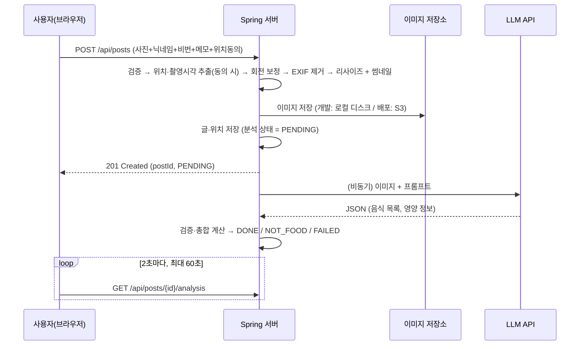

# 음식 사진 칼로리 분석 게시판 — MVP 기획서

> v0.4 · 2026-10-27 · 서비스명 미정
> 이 문서는 살아있는 문서다. 스프린트가 끝날 때마다 갱신하고, 바뀐 결정은 지우지 말고 "변경 이력"에 남긴다.

---

## 1. 한 줄 정의

**가입 없이, 먹은 음식 사진 한 장을 올리면 AI가 칼로리와 탄·단·지(g)를 추정해 주는 공개 음식 기록 게시판.**

## 2. 목표

| 구분 | 목표 |
|---|---|
| 제품 | 첫 방문자가 **가입 없이 30초 안에** "사진 올리기 → 칼로리 확인"까지 끝낸다 |
| 개인(개발자) | 실서버 배포, CI/CD 구축, 실제 사용자 운영, 장애·요청 대응을 직접 겪고 **트러블슈팅 기록**으로 남긴다 |
| 데이터 | 게시글·댓글·피드백은 삭제돼도 DB에 남긴다. 동의한 사용자의 사진 위치·촬영 시각을 쌓아 나중에 2차 가공에 활용한다 |
| 진행 방식 | **꼭 필요한 것만** 만들어 빨리 배포 → 운영하면서 피드백 수집 → 짧은 주기로 개선 (애자일) |

## 3. 핵심 사용 시나리오

1. **기록**: 점심을 먹고 사진을 찍어 올린다 → 몇 초 뒤 "김치찌개 400g · 320kcal · 탄12 단22 지20"을 확인한다.
2. **구경·소통**: 피드에서 다른 사람들이 뭘 먹었는지 보고, 가입 없이 댓글을 단다.
3. **관리**: 잘못 올린 글이나 댓글을 작성 때 입력한 비밀번호로 삭제한다.
4. **건의**: 불편한 점을 피드백 게시판에 남기고, 나중에 "반영 완료" 표시와 운영자 답변을 확인한다.

## 4. MVP 범위 (v1.0)

원칙: **"이게 없으면 서비스가 안 돌아가거나, 운영 중 문제를 볼 수 없는가?"** 에 "예"인 것만 넣는다.

### 4.1 포함

| 기능 | 내용 |
|---|---|
| 게시글 작성 | 사진 1장(필수) + 닉네임 + 비밀번호 + 한 줄 메모(선택) + 위치 정보 제공 동의(선택) |
| AI 분석 | 음식별 이름·추정량(g)·kcal·탄/단/지(g), 총합, 신뢰도, 한 줄 코멘트. 실패 시 서버가 자동 재시도 |
| 피드 | 최신순 무한 스크롤. 썸네일, 닉네임, 총 kcal, 댓글 수, 작성 시간 |
| 상세 | 사진, 음식별 분석 표, 총합, 탄단지 비율 바, 면책 문구, 댓글 |
| 게시글 삭제 | 비밀번호 확인 후 **상태 변경**으로 숨김 (DB에는 남음) |
| 댓글 | 비회원 닉네임 + 비밀번호로 작성·삭제. 대댓글 없는 평면 구조 |
| 피드백 게시판 | 비회원 닉네임 + 비밀번호로 건의·버그 제보 작성·삭제. 운영자가 처리 상태(접수 / 진행 중 / 반영 완료 / 보류)와 답변을 남김 |
| 운영자 기능 | 관리자 API(토큰 인증, 화면 없음)로 게시글·댓글·피드백 **상태 변경**, 피드백 처리 상태·답변 등록 |
| 정책 페이지 | 이용약관·개인정보처리방침 한 페이지 (위치정보, 외부 AI 전송, 면책 포함) |

### 4.2 제외 (백로그 — 사용자 반응 보고 우선순위 결정)

**MVP에서 뺀 것 (v0.3에서 축소)**
- 게시글 메모 수정, 댓글 수정 → MVP는 삭제 후 다시 작성
- 사용자 "재분석" 버튼 → 서버 자동 재시도로 대체
- 비밀번호 시도 횟수 제한 → 실패 로그만 남겨 두고, 공격 징후가 보이면 추가
- 댓글 rate limit → 도배가 생기면 추가
- 지표 기반 알림(분석 실패율 등), 관리자 화면, 삭제 글 복구

**처음부터 제외**
- 회원제(소셜 로그인), 내 기록 모아보기, 일별 칼로리 합계·통계
- 분석 결과 사용자 보정 (예: "밥 반 공기만 먹었어요")
- 대댓글, 좋아요, 신고, 금칙어 필터, 검색·필터
- 위치 데이터 2차 가공 (지역별 인기 음식, 시간대별 평균 칼로리 등)
- 브라우저 Geolocation API로 현재 위치 첨부
- 앱 (PWA 설치, 네이티브 앱 래핑)

> **플랫폼**: MVP는 **웹만** 만든다. 휴대폰에서 주로 쓸 것이므로 모바일 우선 반응형으로 만들고, `<input type="file" accept="image/*" capture>`로 휴대폰 카메라를 바로 쓴다. 앱은 웹 반응을 본 뒤 결정한다.

## 5. 비회원 정책 (게시글·댓글·피드백 공통)

- **작성자 식별**: 계정이 없으므로 "아이디"는 **닉네임**으로 취급한다. 닉네임 중복 허용 (식별용이 아닌 표시용).
- **비밀번호**: 4~20자, **BCrypt 해시로만 저장**. 평문 저장·로그 출력 금지. 비밀번호 실패는 IP 해시와 함께 로그로 남긴다.
- **비밀번호 분실**: 찾기 기능 없음. 작성 화면에 "비밀번호를 잊으면 직접 삭제할 수 없어요" 안내 → 피드백 게시판으로 운영자에게 삭제 요청.
- **댓글**: 500자 이하, 오래된 순 정렬, 20개씩 커서 페이징.
- **피드백**: 제목 100자, 내용 2,000자 이하, 최신순. 누구나 볼 수 있는 공개 게시판이므로 작성 화면에 "연락처 등 개인정보를 적지 마세요" 안내.

### 5.1 삭제 = 상태 변경

게시글·댓글·피드백은 **DB에서 지우지 않는다.** 삭제는 상태값을 바꿔 화면·API에서 안 보이게 하는 것이다.

| status | 의미 | 바꾸는 주체 |
|---|---|---|
| `ACTIVE` | 정상 노출 | 작성 시 기본값 |
| `DELETED_BY_AUTHOR` | 작성자가 삭제 | 작성자 (비밀번호 확인) |
| `DELETED_BY_ADMIN` | 운영자가 삭제 | 운영자 (관리자 API) |

- 상태가 바뀐 시각은 `deleted_at`에 기록한다. 운영자 상태 변경은 애플리케이션 로그에도 남긴다.
- 모든 조회 쿼리는 `status = 'ACTIVE'`만 대상으로 한다. 삭제된 게시글의 상세·댓글은 404.
- 게시글이 삭제되면 댓글 상태는 건드리지 않는다 — 게시글에 접근할 수 없으므로 댓글도 자연히 안 보인다.
- 이미지 파일도 보존한다. 삭제된 글의 이미지 URL은 응답에 넣지 않는다 (S3에서 직접 URL 접근을 막을지는 S4에서 검토).
- **예외 — 위치 정보**: 게시글이 삭제되면 `post_locations` 행은 **완전 삭제**한다. 작성자의 삭제를 위치정보 제공 동의 철회로 보는 것이 안전하다.

## 6. AI 분석 설계

### 6.1 처리 흐름



- **왜 비동기인가**: LLM 응답은 수 초~수십 초 걸린다. 동기로 기다리면 요청 타임아웃·스레드 점유 문제가 생기고, 분석이 실패해도 글은 남아 있어야 재시도할 수 있다.
- **MVP 구현**: Spring `@Async` + 크기 제한 있는 스레드 풀.
- **자동 재시도 (스케줄러)**: 아래 건을 주기적으로 다시 처리한다. 사용자가 누르는 재분석 버튼은 없다.
  - 10분 이상 PENDING인 건 (서버 재시작으로 유실된 작업)
  - FAILED이면서 시도 횟수 3회 미만인 건
  - 일일 한도 초과로 미뤄 둔 건 (다음 날)
- **공급자 교체 가능하게**: `FoodAnalyzer` 인터페이스 뒤에 구현체를 둔다. 무료 → 유료 전환, 공급자 교체가 구현체 추가 + 설정 변경으로 끝난다.

### 6.2 이미지 전처리와 위치 정보

처리 순서: **검증 → 위치·촬영 시각 추출 → 회전 보정 → EXIF 제거 → 리사이즈**

- 허용: JPEG / PNG, 최대 10MB. **확장자가 아니라 파일 시그니처(매직 바이트)로 검증**. (WebP는 Java가 기본으로 읽지 못해 라이브러리가 더 필요하므로 MVP에서 제외)
  - **업로드 한도는 세 군데를 함께 맞춘다**: Spring `max-file-size`(기본 1MB)·`max-request-size`(기본 10MB), Tomcat `max-swallow-size`(기본 2MB — 작으면 한도 초과 시 에러 응답 대신 연결이 끊긴다), Nginx `client_max_body_size`(기본 1MB, S4).
  - 프론트에서 업로드 전에 크기를 먼저 검사한다. 서버 한도는 안전망이고, 초과 시 413을 상태 코드로 처리한다 (Nginx의 413 응답은 JSON이 아니라 HTML).
  - 한도 초과로 거절된 건수를 로그로 세서 한도값을 조정한다.
  - **진짜 한계는 메모리다.** 10MB JPEG도 4,800만 화소일 수 있고, 그대로 디코딩하면 한 장에 150MB 넘는 힙을 쓴다. 디코딩 전에 헤더만 읽어 가로·세로 픽셀 수를 확인해 상한을 두고(예: 5,000만 화소), 이미지 처리 동시 실행 수를 제한한다 (작은 EC2에서 OOM 방지).
  - 브라우저에서 압축해 올리면 용량 문제는 줄지만, canvas 압축은 EXIF(위치)를 지워 위치 수집과 충돌한다 → MVP는 원본을 받아 서버에서 처리한다.
- **위치 정보**
  - 사용자가 "위치 정보 제공 동의(선택, 기본 해제)"를 체크한 경우에만 EXIF의 GPS 좌표를 **별도 테이블**(`post_locations`)에 저장한다. 미동의 시 저장하지 않는다.
  - 공개되는 이미지 파일에는 **어떤 경우에도 EXIF를 남기지 않는다.** 남기면 누구나 사진을 내려받아 작성자의 위치를 볼 수 있다.
  - 좌표는 공개 API로 절대 내보내지 않는다. 2차 가공 결과도 행정구역 단위 같은 집계 형태로만 공개한다.
  - 현실 체크: iOS Safari 등 일부 모바일 브라우저·앱은 업로드할 때 위치 정보를 지워서 보내기도 한다. 수집률을 지표로 측정한다.
- **촬영 시각**(EXIF `DateTimeOriginal`)은 식사 시간대 분석용으로 게시글에 함께 저장한다. 위치와 같은 동의를 받았을 때만 저장하고, EXIF 시각에는 시간대가 없는 경우가 많아 한국 시간으로 해석한다.
- 구현: `ImageProcessor`가 EXIF를 지우기 **전에** metadata-extractor로 GPS·촬영 시각을 꺼내 두고, `PostService`가 동의 여부를 보고 저장한다. 좌표는 `GeoPoint`(VO)로 범위 검사 후 저장. 동의했지만 사진에 GPS가 없으면 `Location consented but no GPS` 로그로 수집률을 센다.
- **EXIF Orientation을 먼저 반영한 뒤 EXIF 제거** — 안 하면 세로 사진이 눕혀져 보이는 고전적인 버그가 난다.
- 원본은 긴 변 1280px로 줄여 JPEG 저장(작은 사진은 키우지 않음), 피드용 썸네일은 가운데를 잘라 **600 × 600 정사각형**으로 별도 생성. LLM에도 줄인 이미지를 보낸다.
  - 썸네일을 400px가 아니라 600px로 한 이유: 휴대폰 목록은 한 줄에 한 장(약 340px)이라 고해상도 화면(2~3배)에서 400px는 흐려 보인다. 600px도 20~40KB 수준.
  - 사진 처리는 트랜잭션 밖에서 한다 (처리하는 동안 DB 연결을 붙잡지 않게).
- 구현: `ImageProcessor` (Thumbnailator) — 매직 바이트 → 화소 수(헤더만 읽음) → EXIF 방향 반영 → 투명 배경은 흰색 → JPEG로 새로 저장(EXIF 제거)
- iPhone HEIC: 브라우저 업로드 시 대부분 JPEG로 변환되지만, 아니면 서버(Java ImageIO)가 읽지 못한다 → 명확한 에러 메시지로 안내하고 로그로 빈도 확인.

### 6.3 출력 형식 (Structured Output)

모델에 JSON 스키마를 강제해서 파싱 실패를 줄인다. (스키마 강제를 지원하지 않는 API라면 프롬프트로 형식을 지시하고 서버에서 엄격히 검증)

```json
{
  "isFood": true,
  "items": [
    { "name": "김치찌개", "amountG": 400, "kcal": 320, "carbsG": 12, "proteinG": 22, "fatG": 20 },
    { "name": "공기밥", "amountG": 210, "kcal": 310, "carbsG": 68, "proteinG": 5, "fatG": 1 }
  ],
  "confidence": "MEDIUM",
  "comment": "찌개는 1인분, 밥은 1공기 기준으로 추정했어요."
}
```

- **총합은 서버에서 items를 더해 계산**한다 (모델이 준 합계와 항목 합이 어긋나는 문제 방지).
- `isFood=false` → 상태 `NOT_FOOD`, "음식을 찾지 못했어요" 표시.
- 값 범위 검증(음수, 한 끼 10,000kcal 같은 이상치) 실패 시 `FAILED`.

### 6.4 LLM 선택 — 첫 배포는 무료 API

- 첫 배포는 **무료 티어 LLM API**로 운영한다. 후보: Google Gemini API 무료 티어, Groq, OpenRouter 무료 모델 등. 무료 조건은 자주 바뀌므로 고르는 시점에 확인한다.
- **결정 (2026-10-30)**: Google AI Studio의 **`gemini-3.5-flash-lite`** (무료: 분당 15건, 하루 500건). 음식 사진 20장 비교에서 20/20 성공, 평균 2.5초, 음식 이름 19/20. 3.8 Flash는 무료 하루 20건에 혼잡(503)·시간 초과가 잦아 제외 → [`ai-model-comparison.md`](ai-model-comparison.md)
- **선택 기준**
  1. 이미지 입력 지원
  2. JSON 스키마 강제(구조화 출력) 지원
  3. 분당·일일 요청 한도
  4. 입력 데이터를 모델 학습에 쓰는지 여부 (무료 티어는 쓰는 경우가 많음 → 처리방침에 고지)
  5. 한국 음식 인식 품질 — 같은 사진 20~30장으로 후보끼리 비교
- **무료 티어 운영 수칙**
  - 429(한도 초과) → 지수 백오프로 재시도.
  - 일일 한도를 다 쓰면 "오늘 분석 한도가 찼어요. 내일 자동으로 분석돼요" 안내 후 PENDING 유지 → 다음 날 스케줄러가 처리.
  - 서비스 일일 분석 상한을 무료 티어 일일 한도보다 조금 낮게 잡는다.
  - 응답 시간, 성공 여부, 사용 토큰을 매 건 DB에 기록한다 → 유료 전환 시점 판단 근거.
- **실패 처리**: 타임아웃, 429/5xx, 응답 파싱 실패, 응답 거부 → `FAILED` + 사유 기록 → 스케줄러가 최대 3회까지 자동 재시도.
- **유료 전환 시 참고** (Claude, 2026-10 단가. 입력 ≈ 2,500토큰, 출력 ≈ 1,000토큰 가정한 1건 추정)

| 모델 | 단가 (입력/출력, 1M 토큰당) | 1건 | 1,000건 |
|---|---|---|---|
| Claude Opus 5.5 | $4 / $20 | ≈ $0.03 | ≈ $30 |
| Claude Sonnet 5.5 | $2 / $10 | ≈ $0.015 | ≈ $15 |
| Claude Haiku 5.5 | $0.10 / $0.50 | ≈ $0.001 | ≈ $1 |

## 7. 남용 방어 (MVP 최소)

| 위험 | 대응 |
|---|---|
| 봇/도배로 무료 LLM 한도 소진 | 게시글 업로드 rate limit (IP당 분당 3건, 하루 30건) + **서비스 전체 일일 분석 상한** |
| 부적절한 이미지·댓글·피드백 | `isFood` 1차 필터 + 운영자 상태 변경 |
| 위치 정보 노출 | 공개 이미지 EXIF 제거, 좌표 비공개, 동의한 경우에만 저장 |
| 대용량·위장 파일 | 크기 제한, 매직 바이트 검증 |

댓글·피드백 작성 제한과 비밀번호 시도 제한은 MVP에서 두지 않는다. 로그로 지켜보다가 문제가 생기면 추가한다.

## 8. 개인정보·고지

- **위치 정보**: 수집 항목(사진의 GPS 좌표·촬영 시각), 목적(지역·시간대별 통계), 보관 기간, 동의 거부 시 불이익 없음을 동의 체크박스 옆과 처리방침에 명시한다.
  - 개인 위치정보를 수집·이용하면 「위치정보의 보호 및 이용 등에 관한 법률」 적용 대상이 될 수 있다(동의, 신고 의무 등). **공개 운영 전에 해당 여부를 확인**한다.
  - 좌표는 **원본 정밀도(소수점 6자리, 약 10cm)**로 저장한다 (18절 결정). 정확한 지점이므로 공개 화면·API는 물론 **로그에도 좌표를 남기지 않는다**. 2차 가공 결과는 행정구역 단위로만 공개한다.
- 사진이 **외부 AI 서비스로 전송**되고, 무료 티어 조건에 따라 공급자의 모델 개선에 쓰일 수 있다는 사실을 처리방침과 업로드 화면에 명시한다.
- **삭제한 게시글·댓글·피드백도 DB에 보관**된다는 사실과 보관 목적(운영·분쟁 대응)을 처리방침에 명시한다.
- IP는 남용 방지 목적으로만, 해시로 저장하고 30일 후 비운다.
- 분석 결과 옆에 항상: "AI 추정치이며 실제와 다를 수 있습니다. 의료·영양 상담을 대신하지 않습니다."

## 9. 기술 스택과 백엔드 구조

### 9.1 스택

| 영역 | 선택 | 비고 |
|---|---|---|
| 화면 | JSP + JSTL (war 패키징) | Spring이 HTML을 만들어 보낸다. 분석 상태 폴링 등 필요한 곳만 JavaScript(fetch) |
| 백엔드 | Spring Boot 4 (Java 17, Amazon Corretto), Spring Web MVC, Data JPA, Validation, Actuator | 자료 대부분이 Boot 3 기준이라 의존성·설정 이름이 다를 수 있음. 빌드·운영 모두 Corretto 17 (`build.gradle` toolchain에 vendor 고정, 배포 이미지 `amazoncorretto:17`) |
| DB | **MySQL 8** (확정) | 분석 결과 items는 JSON 타입 |
| DB 테이블 생성 | JPA `ddl-auto=update` | 엔티티를 보고 테이블을 자동 생성 (로컬·CI). 운영 DB의 스키마 변경 방식은 S4에서 결정 |
| 로컬 개발 환경 | Docker Compose (MySQL) | 배포 환경과 같은 버전으로 맞춤 |
| 이미지 처리 | Thumbnailator + metadata-extractor | 리사이즈, 회전 보정, EXIF 읽기 |
| LLM | 무료 티어 API (6.4) | `FoodAnalyzer` 인터페이스로 추상화 |
| Rate limit | Bucket4j | 게시글 업로드에만 적용 |

### 9.2 백엔드 구조 (Spring MVC 계층형)

Spring이 Controller·Service·Repository(Model) 계층과 화면(JSP, View)까지 맡는다. 화면은 `@Controller`가 JSP 이름을 돌려줘서 만들고, 화면 이동 없이 값만 필요한 곳(분석 상태 폴링)만 `@RestController`로 JSON을 준다.

```
HTTP 요청
  → Controller  (@Controller / @RestController) 요청 검증, DTO → 화면(JSP) 또는 JSON
  → Service     (@Service)        비즈니스 로직, 트랜잭션, 비밀번호 확인, 상태 변경
  → Repository  (Spring Data JPA) 엔티티 조회·저장
  → MySQL
```

패키지는 도메인별로 먼저 나누고, 도메인 안은 `controller / service / model(entity, dto, repository)`로 같은 모양을 쓴다.

```
backend
├─ post/              게시글 (S1)
│  ├─ controller/       PostController
│  ├─ service/          PostService
│  └─ model/
│     ├─ entity/          Post, PostStatus
│     ├─ dto/             PostCreateForm, PostSummary, FeedPage
│     └─ repository/      PostRepository
├─ location/          위치 (S1-4): PostLocation 엔티티, GeoPoint(VO) — 같은 모양
├─ analysis/          AI 분석 (S2): FoodAnalyzer(인터페이스)·공급자 구현체·재시도 스케줄러 — 같은 모양
├─ comment/           댓글 (S3) — 같은 모양
├─ feedback/          피드백 게시판 (S3) — 같은 모양
├─ admin/             운영자 API (S3)
├─ image/             도메인이 아닌 도구: 사진 저장(LocalImageStorage → S4에서 S3), 사진 처리(S1-3)
└─ common/            예외 처리·에러 응답, traceId 로그, 비밀번호 해시 설정, (S2) rate limit
```

**계층 규칙**
- 엔티티를 응답으로 그대로 내보내지 않고 DTO로 변환한다 — `password_hash`, 위치 좌표가 실수로 노출되는 것을 막는다.
- **DTO와 VO**: 데이터를 나르는 객체는 DTO(`dto/`)로 부르고, 화면으로만 보내는 DTO는 `record`로 만들어 바뀌지 않게 한다. VO(값 객체)는 값 자체에 규칙이 있는 묶음에만 쓴다 (예: 위치 좌표 `GeoPoint` — 범위 검사·정밀도 규칙).
- 트랜잭션 경계는 Service에 둔다.
- **LLM 호출은 트랜잭션 밖에서** 한다. 트랜잭션 안에서 10초 넘게 외부 API를 기다리면 DB 커넥션 풀이 고갈된다 (운영에서 자주 터지는 장애).
- 조회 쿼리에서 `status = 'ACTIVE'` 조건을 빠뜨리지 않는다 (삭제 글 노출 버그의 단골 원인). Repository 메서드 이름이나 공통 조건으로 강제한다.
- 피드 조회 시 분석 결과·댓글 수를 함께 가져오면서 생기는 **N+1 쿼리**를 주의한다. MVP는 fetch join / COUNT 쿼리로 시작하고, 느려지면 댓글 수 비정규화 컬럼을 검토한다.

### 9.3 꼭 지킬 기본기

- **비밀값은 Git에 올리지 않는다.** LLM API 키, DB 비밀번호, 관리자 토큰은 환경 변수로 주입한다. 로컬은 `.env`(`.gitignore` 등록) + `application-local.yml`, 운영은 S4에서 AWS 환경 변수 / Parameter Store. 공개 레포에 키가 올라가면 몇 분 안에 자동 수집된다.
- **핵심 로직은 테스트한다.** 비밀번호 확인, 삭제 상태 변경, 분석 응답 검증·총합 계산, 업로드 검증. CI가 push마다 실행한다 (S4부터는 PR마다).
- **시간은 UTC로 저장하고 KST로 표시한다.** EC2·RDS 기본 시간대가 UTC라서 "9시간 차이" 버그가 자주 난다.

## 10. 인프라·배포

- **개발 단계 (S0~S3)**: 로컬에서 Docker Compose로 MySQL을 띄우고, 이미지는 로컬 디스크(`LocalImageStorage`)에 저장한다.
- **배포 단계 (S4)**: **AWS**로 배포한다. 상세 구성과 예산은 그 시점에 확정한다. 현재 예상 구성:

```
[사용자] ─ HTTPS ─ EC2 [Nginx → Spring Boot war (Docker), 화면(JSP) 포함] ─ RDS MySQL
         └ HTTPS ─ CloudFront ─ S3 (음식 이미지)
                                                    └─ LLM API
GitHub (main push) → GitHub Actions → Docker 이미지 빌드 → 레지스트리 → EC2에서 pull & 재시작
```

- 이미지 저장소를 인터페이스로 분리해 두었으므로 로컬 → S3 전환은 구현체 교체와 설정 변경으로 끝난다.
- 운영 서버의 로컬 디스크에 이미지 저장 금지 — 컨테이너 재배포 시 사라진다.
- 롤백: Docker 이미지 태그를 커밋 SHA로 남겨 이전 버전으로 즉시 되돌릴 수 있게 한다.

**S4 배포 체크리스트** (처음 배포할 때 자주 터지는 것들)
- [ ] 업로드 한도: Nginx `client_max_body_size`가 Spring 한도와 맞는지 (6.2절)
- [ ] JVM 힙(`-Xmx`)과 컨테이너 메모리 한도 지정 (이미지 디코딩 OOM 방지)
- [ ] 이미지 처리 동시 실행 수 제한 (6.2절. S1에서는 화소 수 한도만 넣음 — 서버 메모리 크기가 정해지는 S4에서 수치와 함께 결정)
- [ ] 비밀값: 환경 변수 주입, 레포·이미지에 포함되지 않았는지 확인
- [ ] 시간대: JVM·MySQL 시간대 설정, 화면 표시 KST 확인
- [ ] Docker 로그 로테이션 (안 하면 디스크가 가득 차서 서버가 멈춘다)
- [ ] DB 자동 백업 켜기 + 복구 1회 해보기
- [ ] JSP 개발 모드 끄기 (`server.servlet.jsp.init-parameters.development=false`)
- [ ] Nginx 뒤에서 실제 사용자 IP 받기 (`server.forward-headers-strategy` + Nginx `X-Forwarded-For`). 안 하면 모든 요청이 Nginx IP 하나로 보여서 업로드 횟수 제한이 전체 사용자를 한꺼번에 막는다
- [ ] CSS 같은 정적 파일 주소에 버전 붙이기 (배포 후에도 브라우저가 예전 CSS를 쓰는 문제 방지)

## 11. 운영·관측 (MVP 최소)

트러블슈팅 경험이 목표이므로, **문제가 생겼을 때 원인을 볼 수 있는 장치를 기능보다 먼저** 깐다.

**개발 단계부터 (S0~)**
- 요청마다 traceId (MDC, 응답 헤더 `X-Trace-Id`) + 요청 기록 로그 한 줄 (메서드, 경로, 상태, 걸린 시간)
- 공통 에러 응답 포맷과 예외 처리
- 분석 건별로 공급자, 모델, 토큰, 지연시간, 결과 상태 기록
- 비밀번호 실패, 운영자 상태 변경, rate limit 차단 로그

**배포 단계에서 (S4~)**
- **JSON 구조화 로그**: 설정 한 줄(`logging.structured.format.console=ecs`)로 켠다. 로컬은 읽기 쉬운 글자 형식 유지
- **에러 추적 + 알림**: Sentry (프론트 + 백엔드). 새 에러가 나면 메일로 알림
- **다운 알림**: 외부 업타임 모니터가 `/actuator/health`를 확인, 응답 없으면 알림
- **백업**: RDS 자동 백업

**장애 기록**: `docs/troubleshooting/YYYY-MM-DD-제목.md` — 현상 / 영향 / 원인 / 해결 / 재발 방지 (개발 중 발견한 문제도 같은 형식으로 남긴다)

## 12. 데이터 모델 (MySQL 8 초안)

**posts**

| 컬럼 | 타입 | 비고 |
|---|---|---|
| id | BIGINT PK AUTO_INCREMENT | |
| nickname | VARCHAR(20) | |
| password_hash | VARCHAR(100) | BCrypt |
| memo | VARCHAR(300) | nullable |
| image_key / thumbnail_key | VARCHAR(255) | 저장소 키 |
| photo_taken_at | DATETIME(6) | nullable, EXIF 촬영 시각 |
| status | VARCHAR(30) | `ACTIVE` / `DELETED_BY_AUTHOR` / `DELETED_BY_ADMIN`, 인덱스 (status, id) |
| ip_hash | VARCHAR(64) | 남용 대응용, 30일 후 NULL |
| created_at / deleted_at | DATETIME(6) | deleted_at = 상태 변경 시각 |

**comments**

| 컬럼 | 타입 | 비고 |
|---|---|---|
| id | BIGINT PK AUTO_INCREMENT | |
| post_id | BIGINT FK | 인덱스 (post_id, status, id) |
| nickname | VARCHAR(20) | |
| password_hash | VARCHAR(100) | BCrypt |
| content | VARCHAR(500) | |
| status | VARCHAR(30) | posts와 동일 |
| ip_hash | VARCHAR(64) | 30일 후 NULL |
| created_at / deleted_at | DATETIME(6) | |

**post_locations** (posts와 1:1, 동의한 경우에만 생성)

| 컬럼 | 타입 | 비고 |
|---|---|---|
| post_id | BIGINT PK, FK | |
| latitude / longitude | DECIMAL(9,6) | 원본 정밀도(소수점 6자리) 그대로 저장 (18절) |
| source | VARCHAR(20) | `EXIF` (추후 `GEOLOCATION`) |
| consented_at | DATETIME(6) | 동의 시각 |

게시글 삭제 시 이 행만 hard delete (5.1절 예외). 공개 API 응답에 포함하지 않는다.

**food_analyses** (posts와 1:1)

| 컬럼 | 타입 | 비고 |
|---|---|---|
| id | BIGINT PK AUTO_INCREMENT | |
| post_id | BIGINT FK UNIQUE | |
| status | VARCHAR(20) | PENDING / DONE / NOT_FOOD / FAILED |
| total_kcal, carbs_g, protein_g, fat_g | DECIMAL(7,1) | 서버에서 계산 |
| items | JSON | 음식별 상세 |
| confidence, comment | VARCHAR | |
| provider, model, input_tokens, output_tokens, latency_ms | | 성능·한도 추적 |
| attempt_count, error_message | | 자동 재시도·장애 분석 |
| created_at, completed_at | DATETIME(6) | |

**feedbacks**

| 컬럼 | 타입 | 비고 |
|---|---|---|
| id | BIGINT PK AUTO_INCREMENT | |
| nickname | VARCHAR(20) | |
| password_hash | VARCHAR(100) | BCrypt |
| title | VARCHAR(100) | |
| content | VARCHAR(2000) | |
| status | VARCHAR(30) | posts와 동일 (삭제 = 상태 변경) |
| progress | VARCHAR(20) | `RECEIVED` / `IN_PROGRESS` / `DONE` / `ON_HOLD` |
| admin_reply | VARCHAR(1000) | nullable, 운영자 답변 |
| replied_at | DATETIME(6) | nullable |
| ip_hash | VARCHAR(64) | 30일 후 NULL |
| created_at / deleted_at | DATETIME(6) | |

## 13. 화면 주소·API

화면은 JSP로 만들고, HTML form은 GET·POST만 보낼 수 있으므로 삭제도 POST로 받는다. 저장·삭제 후에는 목록으로 redirect한다 (새로고침 시 중복 저장 방지).

**게시글 (S1)**

| Method | Path | 설명 |
|---|---|---|
| GET | `/` | 목록 (최신순 20개, ACTIVE만). "더 보기" = `/?cursor={마지막 글 id}` |
| GET | `/posts/new` | 글쓰기 화면 |
| POST | `/posts` | multipart(image, nickname, password, memo) 저장 → `/`로 이동. 검사에 걸리면 글쓰기 화면에 칸별 메시지 |
| GET | `/posts/{id}` | 상세 화면 (S1-2) |
| POST | `/posts/{id}/delete` | 비밀번호 확인 → `DELETED_BY_AUTHOR` → `/`로 이동 (S1-2) |
| GET | `/images/{파일이름}` | 저장한 사진 (개발: `uploads/` 폴더, 배포: S3) |

**JSON API (화면 이동 없이 값만 필요한 곳)**

| Method | Path | 설명 |
|---|---|---|
| GET | `/api/posts/{id}/analysis` | 분석 상태 (S2, 상세 화면의 JavaScript가 2초마다 확인) |

**S3에서 같은 방식으로 정리**: 댓글(작성·삭제), 피드백 게시판(목록·상세·작성·삭제), 운영자 API(관리자 토큰, 상태 변경·피드백 답변)

에러는 `ErrorCode`(enum)에 모으고, 요청 종류에 따라 두 곳에서 응답한다. 둘 다 HTTP 상태를 그대로 보내고, `traceId`(응답 헤더 `X-Trace-Id`와 같은 값)를 함께 보여 줘서 사용자가 알려 주면 서버 로그를 찾을 수 있다.
- **화면 요청** (`PageExceptionHandler`): 에러 화면 `common/error.jsp` (상태, 메시지, traceId). 없는 주소·잘못된 방식·너무 큰 사진도 여기로 온다.
- **JSON API** (`@RestController`, `ApiExceptionHandler`): `{ "code": "INVALID_PASSWORD", "message": "...", "traceId": "..." }`
- 예외: 삭제 비밀번호가 틀리면 에러 화면 대신 상세 화면으로 돌아가 메시지를 보여 준다 (flash).

## 14. 화면 구성

1. **피드(홈)**: 카드 리스트(사진, 닉네임, 총 kcal, 탄단지 비율 바, 댓글 수, "3분 전") + 우하단 "올리기" 버튼
2. **작성**: 사진 촬영/선택 → 미리보기 → 닉네임·비밀번호·메모 → 위치 정보 제공 동의(선택) → 올리기
3. **상세**: 사진, 분석 중 로딩 → 음식별 표 + 총합 + 비율 바 + 면책 문구, 삭제 버튼, 댓글 목록과 입력창(닉네임·비밀번호·내용)
4. **비밀번호 확인 모달** (게시글·댓글·피드백 삭제 공용)
5. **피드백 게시판** (상단 메뉴 "피드 · 피드백"으로 이동): 목록(제목, 처리 상태 배지, 닉네임, 시간) / 상세(내용 + 운영자 답변) / 작성
6. **이용약관·개인정보처리방침**

## 15. 로드맵 (1주 스프린트 기준)

> **진행 순서 변경 (2026-10-30)**: S0 → S1 → **배포 준비 3가지 → S4 배포** → S2 나머지(AI) → S3.
> 이 프로젝트의 목표가 배포·운영 경험이므로, 동작하는 S1을 먼저 실서버에 올리고 AI·댓글은 **배포된 서비스에 업데이트로 붙이며** 애자일 사이클을 돌린다.
> 배포 준비 3가지: ① 사진 저장소(서버에서 사라지지 않게) ② 개인정보처리방침 페이지 ③ 업로드 횟수 제한(S2에서 당겨 옴)

| 스프린트 | 목표 | 완료 기준 |
|---|---|---|
| **S0. 개발 환경** | 모노레포, Spring Boot(JSP) 초기화, Docker Compose(MySQL), 비밀값 분리(.env), GitHub Actions CI(빌드·테스트), traceId 로그·공통 에러 포맷 | 로컬에서 화면(JSP) → Spring → MySQL 왕복 확인, PR마다 CI 통과 |
| **S1. 게시판** | 업로드(검증·위치 추출·회전 보정·EXIF 제거·리사이즈), 피드·상세, 작성자 삭제(상태 변경) | 휴대폰 사진을 올리고 지울 수 있고, 동의 시 위치가 저장된다 |
| **S2. AI 분석** | LLM 비교·선정(✅ S2-1), 비동기 분석, 구조화 출력, 폴링 UI, 자동 재시도 스케줄러, 일일 상한 (업로드 rate limit은 배포 준비로 이동) | 사진 올리면 칼로리가 뜨고, 실패·한도 초과 시에도 자동 복구된다 |
| **S3. 댓글 + 피드백 게시판 + 운영 기능** | 댓글 작성·삭제, 피드백 게시판(작성·삭제·처리 상태·답변), 운영자 API, 정책 페이지 | 기능 기준 MVP 완성 |
| **S4. AWS 배포 + 관측** | EC2·RDS·S3/CloudFront, CI/CD 자동 배포, 도메인·HTTPS, JSON 로그, Sentry·업타임 모니터·백업, 배포 체크리스트(10절) | main에 push하면 자동 배포되고, 장애 시 알림이 온다 → 지인 5~10명 베타 |
| **이후** | 공개 + 운영 사이클 | 피드백 → 이슈 → 우선순위 → 스프린트 → 배포 → 회고 |

**S1 조각** (조각마다 DB부터 화면까지 한 번에 만들고 바로 확인)

| # | 조각 | 끝나면 되는 것 | 상태 |
|---|---|---|---|
| 1 | 글쓰기 + 목록 | 사진·닉네임·비밀번호·메모를 올리면 목록에 보인다 (사진은 받은 그대로 저장) | 완료 |
| 2 | 상세 + 삭제 | 상세 화면, 비밀번호 확인 후 상태 변경, 없는 글은 에러 화면 | 완료 |
| 3 | 사진 처리 | 매직 바이트 검사(JPEG·PNG), 회전 보정, EXIF 제거, 리사이즈·썸네일 | 완료 |
| 4 | 위치·촬영 시각 | 동의 시 GPS → `post_locations`, 삭제 시 위치 완전 삭제 | 완료 |

휴대폰 실기기 테스트(아이폰 Safari): 올리기·지우기 ✅, 동의 시 위치 저장 ✅ (사진 보관함에서 고른 사진). 브라우저에서 바로 찍은 사진은 아이폰이 위치 없이 넘겨준다 → `docs/troubleshooting/2026-10-30-iphone-gps-missing.md`. 테스트 중 발견한 연속 누름 중복 등록은 수정 → `docs/troubleshooting/2026-10-30-double-submit.md`. 안드로이드(삼성 Chrome): 올리기·지우기·회전 ✅, 동의 시 촬영 시각 저장 ✅, 위치는 GPS 없이 도착(카메라 위치 태그 꺼짐 또는 안드로이드의 위치 정보 제거 — 같은 트러블슈팅 문서).

단순하게 시작하기 위해: 무한 스크롤 대신 "더 보기" 링크, 사진은 JPEG·PNG만 (WebP는 추가 라이브러리 필요), IP 해시는 S2 rate limit과 함께.

## 16. 운영 프로세스

- **백로그**: GitHub Projects 칸반 — Backlog / Next / In Progress / Done (4.2절 항목을 이슈로 등록)
- **이슈 라벨**: `bug` · `feature` · `user-request` · `ops` · `tech-debt`
- **피드백 → 이슈 → 답변**: 피드백 게시판 글 중 처리할 것은 GitHub 이슈(`user-request`)로 옮겨 진행 상태를 "진행 중"으로 바꾸고, 배포되면 "반영 완료"와 답변을 남긴다.
- **브랜치**: S1~S3은 `main`에 직접 커밋·push하고, CI는 push 후에 확인한다 (❌면 다음 커밋으로 고침). **S4부터** `main` = 배포 대상이 되므로 작업은 `feat/*`, `fix/*`, `chore/*` → PR → CI 통과 후 머지 (머지 시 자동 배포, "CI 통과해야 머지" 규칙도 이때 켬)
- **커밋 메시지**: `feat`(기능 추가·변경) / `fix`(버그 수정) / `chore`(그 외 전부) + 한국어 요약. 한 줄 비우고 세부 내용과 이유를 적는다. PR 제목도 같은 형식
  ```
  fix: 세로 사진이 눕혀지는 문제 수정

  - EXIF 회전 정보를 읽어 저장 전에 회전 보정
  ```
- **릴리즈 노트**: `CHANGELOG.md`
- **회고**: 스프린트마다 KPT (Keep / Problem / Try) 3줄 → `docs/SPRINTS.md`에 스프린트 진행 기록(한 일·만난 문제·바뀐 결정)과 함께 남긴다

## 17. 성공 지표 (공개 후 4주)

- 주간 업로드 수, 댓글 수, 피드백 건수
- 분석 성공률 ≥ 95%, p95 분석 시간 < 15초
- 무료 LLM 일일 한도 사용률 (유료 전환 판단 근거)
- 위치 정보 수집률 = 동의율 × GPS 포함 사진 비율

MVP에서는 DB 쿼리로 직접 확인한다. 대시보드는 필요해지면 만든다.

## 18. 결정 사항

**확정**

| 항목 | 결정 | 일자 |
|---|---|---|
| DB | MySQL 8 | 2026-10-27 |
| 백엔드 구조 | Spring MVC 계층형 REST API (Controller → Service → Repository) | 2026-10-27 |
| 인프라 | AWS, 배포 단계(S4)에서 구성 | 2026-10-27 |
| LLM | 첫 배포는 무료 티어 API | 2026-10-27 |
| LLM 모델 | Google AI Studio `gemini-3.5-flash-lite` (무료 하루 500건). 무료 등급은 사진이 Google 제품 개선에 쓰일 수 있음 → 글쓰기 화면·처리방침에 안내 | 2026-10-30 |
| LLM 요금 | **유료 등급으로 전환** (결제 수단 등록, 8,000원 선결제). 유료 등급은 사진이 Google 제품 개선에 쓰이지 않음 → "제품 개선" 안내는 불필요, 처리방침에 "분석을 위해 Google로 전송" 사실만 적는다 (AI 기능을 배포할 때) | 2026-10-30 |
| 진행 순서 | S1 다음에 배포 준비 3가지 → S4 배포를 먼저 하고, AI(S2)·댓글(S3)은 배포 후 업데이트로 | 2026-10-30 |
| 위치 정보 | EXIF GPS를 동의 기반으로 별도 저장 (공개 이미지에는 제거) | 2026-10-27 |
| 댓글 | MVP 포함, 비회원 닉네임 + 비밀번호, rate limit 없음 | 2026-10-27 |
| 업로드 제한 | 게시글 업로드에 IP별 rate limit 적용 | 2026-10-27 |
| 삭제 방식 | 게시글·댓글·피드백은 상태 변경으로 숨김(DB 보존). 운영자 삭제도 상태 변경. 위치 정보만 완전 삭제 | 2026-10-27 |
| MVP 범위 | 수정 기능, 재분석 버튼, 비밀번호 시도 제한은 백로그로 | 2026-10-27 |
| 플랫폼 | MVP는 웹만 (모바일 우선 반응형). 앱은 이후 결정 | 2026-10-27 |
| 피드백 | 앱 내 피드백 게시판 (비회원, 처리 상태·운영자 답변) | 2026-10-27 |
| Java | Java 17 + Amazon Corretto (로컬·CI·운영 동일). 21에서 변경 | 2026-10-28 |
| CI | GitHub Actions. 설정 파일은 얇게: 실제 명령은 `gradlew`·`npm` 스크립트에 두고, 테스트용 MySQL은 가능하면 `compose.yaml`을 재사용 → 다른 CI 도구로 옮기기 쉽게. Jenkins 직접 운영은 MVP 이후 학습 과제 | 2026-10-28 |
| 커밋 메시지 | `feat` / `fix` / `chore` + 한국어 요약, 빈 줄 뒤 세부·이유 (16절) | 2026-10-28 |
| 작업 흐름 | 배포 전(S1~S3)에는 PR 없이 `main`에 직접 push (혼자 개발, 속도 우선). S4부터 PR + CI 통과 후 머지 | 2026-10-29 |
| 위치 정밀도 | 원본 그대로(소수점 6자리, 약 10cm) 저장. 나중의 분석 자유도를 우선하고, 대신 좌표는 화면·API·로그 어디에도 내보내지 않는다 | 2026-10-30 |
| 촬영 시각 | 위치와 같은 동의를 받았을 때만 저장 (동의 문구 하나로 위치·촬영 시각을 함께 안내) | 2026-10-30 |
| 로그 형식 | 로컬은 글자 형식 + `[traceId]`, JSON(ECS)은 배포(S4)에서 켬. 로그 검색 도구가 생기는 시점에 맞춤 | 2026-10-29 |
| 화면 | React를 빼고 JSP + JSTL로 Spring이 화면까지 만든다 (war 패키징). 서버 하나로 배포가 단순해지고, 최소 구성으로 시작 | 2026-10-29 |
| DB 테이블 생성 | Flyway를 빼고 JPA `ddl-auto=update`로 자동 생성. 개발 단계에서는 SQL 파일 관리보다 단순함을 우선. 운영 DB 방식은 미정 6번 | 2026-10-29 |

**미정**

| # | 항목 | 권장안 / 결정 시점 |
|---|---|---|
| 1 | 서비스 이름 / 도메인 | S4 전까지 |
| 2 | ~~무료 LLM 공급자~~ | 결정됨 → 18절 (`gemini-3.5-flash-lite`) |
| 3 | ~~위치 좌표 저장 정밀도~~ | 결정됨 → 18절 (원본 6자리) |
| 4 | 레포 구조 | 모노레포 권장 (`backend/`, `infra/`, `docs/`) — 화면은 JSP라 `backend/` 안에 있음 |
| 5 | AWS 상세 구성·월 예산 | S4에서 결정 |
| 6 | 운영 DB의 스키마 변경 방식 | S4에서 결정. 운영에서는 `ddl-auto`를 `validate` 또는 `none`으로 두고, 테이블 변경 SQL을 직접 관리하는 것이 일반적 (Flyway 재도입 포함 검토) |

## 변경 이력

- 2026-10-30 — 진행 순서 변경: 배포 준비 3가지 → S4 배포를 S2보다 먼저. Gemini API 유료 등급 전환
- 2026-10-30 — S2-1 완료: AI 모델을 `gemini-3.5-flash-lite`로 결정 (사진 20장 비교)
- 2026-10-30 — S1 완료 (아이폰 실기기 확인). 스프린트 기록(`SPRINTS.md`)과 트러블슈팅 기록 시작
- 2026-10-30 — S1-4(위치·촬영 시각) 완료. 위치 정밀도는 원본 6자리로 결정, 촬영 시각은 동의 시에만 저장
- 2026-10-29 — S1-3(사진 처리) 완료. 썸네일 400px → 600 × 600 정사각형, WebP 제외, 이미지 처리 동시 실행 제한은 S4로
- 2026-10-29 — S1-2(상세 + 삭제) 완료. 에러 처리를 화면(에러 화면)과 JSON API로 나눔
- 2026-10-29 — 패키지 구조를 도메인별 `controller / service / model(entity, dto, repository)`로 정리, DTO·VO 구분 규칙 추가
- 2026-10-29 — S1을 JSP 기준 4조각으로 다시 나눔, 13절을 화면 주소 중심으로 정리. S1-1(글쓰기 + 목록) 완료
- 2026-10-29 — 배포 전까지는 PR 없이 main에 직접 push, PR은 S4부터
- 2026-10-29 — 화면을 React에서 JSP로 변경 (war 패키징, frontend 폴더와 CI frontend 검사 제거)
- 2026-10-29 — Flyway 제거, JPA `ddl-auto=update`로 테이블 자동 생성 (운영 방식은 S4에서 결정)
- 2026-10-29 — JSON 로그를 S0에서 S4로 옮김 (S0은 traceId + 요청 기록 로그)
- 2026-10-28 — CI 도구(GitHub Actions, Jenkins는 이후 학습 과제)와 커밋 메시지 규칙 결정
- 2026-10-28 — Java 21 → Java 17(Amazon Corretto)로 변경
- 2026-10-28 — 실제 생성된 백엔드에 맞춰 Spring Boot 4로 수정
- 2026-10-27 v0.4 — MVP는 웹만으로 확정 · 피드백 게시판 추가(처리 상태·운영자 답변) · 업로드 한도·이미지 디코딩 메모리 설계 보강
- 2026-10-27 v0.3 — 삭제를 상태 변경(soft delete)으로 통일, 운영자 삭제 포함 · 댓글 rate limit 제거 · MVP 축소(수정·재분석 버튼·비밀번호 시도 제한·앱 내 피드백 → 백로그, 알림은 Sentry·업타임으로 단순화) · 비밀값 관리·핵심 테스트·시간대 기본기와 S4 배포 체크리스트 추가
- 2026-10-27 v0.2 — 댓글(비회원) MVP 포함 · 사진 위치 정보를 동의 기반으로 수집하도록 변경 · 첫 배포 LLM을 무료 API로 변경 · DB MySQL 확정 · 백엔드 MVC 계층 구조 추가 · AWS 배포를 S4로 옮기고 로드맵 재구성
- 2026-10-27 v0.1 — 초안 작성
