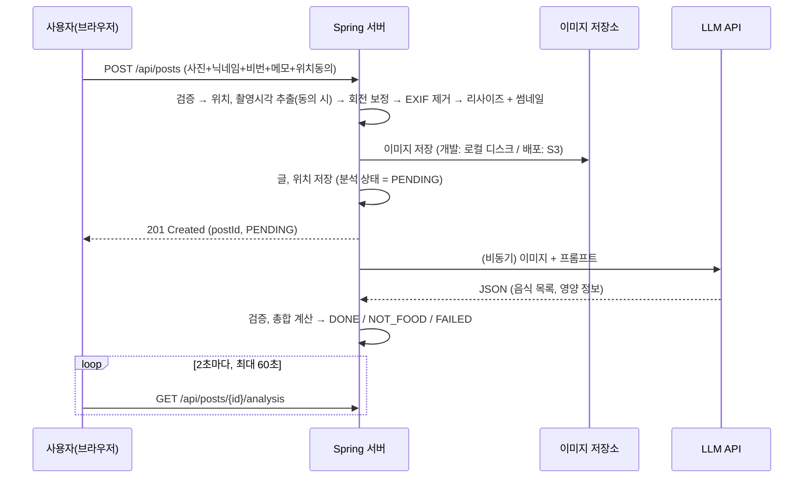

# 찍먹 — 음식 사진 칼로리 분석 게시판 MVP 기획서

> v0.4, 2026-10-27, 서비스명 찍먹 (jjikmuk.com, 2026-11-03)
> 이 문서는 살아있는 문서다. 스프린트가 끝날 때마다 갱신하고, 바뀐 결정은 지우지 말고 "변경 이력"에 남긴다.

---

## 1. 한 줄 정의

**가입 없이, 먹은 음식 사진 한 장을 올리면 AI가 칼로리와 탄, 단, 지(g)를 추정해 주는 공개 음식 기록 게시판.**

## 2. 목표

| 구분 | 목표 |
|---|---|
| 제품 | 첫 방문자가 **가입 없이 30초 안에** "사진 올리기 → 칼로리 확인"까지 끝낸다 |
| 개인(개발자) | 실서버 배포, CI/CD 구축, 실제 사용자 운영, 장애, 요청 대응을 직접 겪고 **트러블슈팅 기록**으로 남긴다 |
| 데이터 | 게시글, 댓글, 피드백은 삭제돼도 DB에 남긴다. 동의한 사용자의 사진 위치, 촬영 시각을 쌓아 나중에 2차 가공에 활용한다 |
| 진행 방식 | **꼭 필요한 것만** 만들어 빨리 배포 → 운영하면서 피드백 수집 → 짧은 주기로 개선 (애자일) |

## 3. 핵심 사용 시나리오

1. **기록**: 점심을 먹고 사진을 찍어 올린다 → 몇 초 뒤 "김치찌개 400g, 320kcal, 탄12 단22 지20"을 확인한다.
2. **구경, 소통**: 피드에서 다른 사람들이 뭘 먹었는지 보고, 가입 없이 댓글을 단다.
3. **관리**: 잘못 올린 글이나 댓글을 작성 때 입력한 비밀번호로 삭제한다.
4. **건의**: 불편한 점을 피드백 게시판에 남기고, 나중에 "반영 완료" 표시와 운영자 답변을 확인한다.

## 4. MVP 범위 (v1.0)

원칙: **"이게 없으면 서비스가 안 돌아가거나, 운영 중 문제를 볼 수 없는가?"** 에 "예"인 것만 넣는다.

### 4.1 포함

| 기능 | 내용 |
|---|---|
| 게시글 작성 | 사진 1장(필수) + 닉네임 + 비밀번호 + 한 줄 메모(선택) + 위치 정보 제공 동의(선택) |
| AI 분석 | 음식별 이름, 추정량(g), kcal, 탄/단/지(g), 총합, 신뢰도, 한 줄 코멘트. 실패 시 자동 재시도는 배포 뒤로 미룸 (6.1절) |
| 피드 | 최신순 무한 스크롤. 썸네일, 닉네임, 총 kcal, 댓글 수, 작성 시간. 2026-11-11부터 좋아요 수와 조회수도 보여 주고, 메모는 상세에서만 보인다 (JM-59, JM-72) |
| 상세 | 사진, 음식별 분석 표, 총합, 탄단지 비율 바, 면책 문구, 댓글 |
| 게시글 삭제 | 비밀번호 확인 후 **상태 변경**으로 숨김 (DB에는 남음) |
| 댓글 | 비회원 닉네임 + 비밀번호로 작성, 삭제. 댓글 아래에 답글을 한 단계만 달 수 있다 (2026-11-11, JM-58. 그 전에는 평면 구조) |
| 좋아요, 조회수 | 글 상세의 좋아요 버튼(가입 없이 누르고 취소는 없음)과 글 조회수. 숫자만 저장한다 (2026-11-11, JM-59, JM-72. 좋아요는 지인 피드백 9번) |
| 피드백 게시판 | 비회원 닉네임 + 비밀번호로 건의, 버그 제보 작성, 삭제. 운영자가 처리 상태(접수 / 진행 중 / 반영 완료 / 보류)와 답변을 남김 |
| 운영자 기능 | 관리자 API(토큰 인증, 화면 없음)로 게시글, 댓글, 피드백 **상태 변경**, 피드백 처리 상태, 답변 등록 |
| 정책 페이지 | 이용약관 `/terms`, 개인정보처리방침 `/privacy` 두 페이지, 모든 화면의 바닥글에서 연결 (위치정보, 외부 AI 전송, 면책 포함) |

### 4.2 제외 (백로그 — 사용자 반응 보고 우선순위 결정)

**MVP에서 뺀 것 (v0.3에서 축소)**
- 게시글 메모 수정, 댓글 수정 → MVP는 삭제 후 다시 작성
- 사용자 "재분석" 버튼 → 서버 자동 재시도로 대체 예정 (자동 재시도도 배포 뒤로 미룸)
- 비밀번호 시도 횟수 제한 → 실패 로그만 남겨 두고, 공격 징후가 보이면 추가
- 댓글 rate limit → 도배가 생기면 추가
- 지표 기반 알림(분석 실패율 등), 관리자 화면, 삭제 글 복구

**처음부터 제외**
- 회원제(소셜 로그인), 내 기록 모아보기, 일별 칼로리 합계, 통계
- 분석 결과 사용자 보정 (예: "밥 반 공기만 먹었어요")
- ~~대댓글~~ (2026-11-11, JM-58로 추가), ~~좋아요~~ (2026-11-11, JM-59로 추가), 신고, 금칙어 필터, 검색, 필터
- 위치 데이터 2차 가공 (지역별 인기 음식, 시간대별 평균 칼로리 등)
- 브라우저 Geolocation API로 현재 위치 첨부
- 앱 (PWA 설치, 네이티브 앱 래핑)

> **플랫폼**: MVP는 **웹만** 만든다. 휴대폰에서 주로 쓸 것이므로 모바일 우선 반응형으로 만들고, `<input type="file" accept="image/*" capture>`로 휴대폰 카메라를 바로 쓴다. 앱은 웹 반응을 본 뒤 결정한다.

## 5. 비회원 정책 (게시글, 댓글, 피드백 공통)

- **작성자 식별**: 계정이 없으므로 "아이디"는 **닉네임**으로 취급한다. 닉네임 중복 허용 (식별용이 아닌 표시용).
- **비밀번호**: 4~20자, **BCrypt 해시로만 저장**. 평문 저장, 로그 출력 금지. 비밀번호 실패는 IP 해시와 함께 로그로 남긴다.
- **비밀번호 분실**: 찾기 기능 없음. 작성 화면에 "비밀번호를 잊으면 직접 삭제할 수 없어요" 안내 → 피드백 게시판으로 운영자에게 삭제 요청.
- **댓글**: 500자 이하, 오래된 순 정렬, 20개씩 커서 페이징.
- **답글** (2026-11-11, JM-58): 댓글과 같은 규칙으로 쓰고 지운다. 댓글 아래에 한 단계만 달 수 있고(답글에 답글은 안 된다), 달린 댓글 아래에 오래된 순으로 모두 보여 준다. 20개 페이징은 댓글만 세고, "댓글 N개"와 목록 카드의 댓글 수에는 답글도 센다.
- **피드백**: 제목 100자, 내용 2,000자 이하, 최신순. 누구나 볼 수 있는 공개 게시판이므로 작성 화면에 "연락처 등 개인정보를 적지 마세요" 안내.

### 5.1 삭제 = 상태 변경

게시글, 댓글, 피드백은 **DB에서 지우지 않는다.** 삭제는 상태값을 바꿔 화면, API에서 안 보이게 하는 것이다.

| status | 의미 | 바꾸는 주체 |
|---|---|---|
| `ACTIVE` | 정상 노출 | 작성 시 기본값 |
| `DELETED_BY_AUTHOR` | 작성자가 삭제 | 작성자 (비밀번호 확인) |
| `DELETED_BY_ADMIN` | 운영자가 삭제 | 운영자 (관리자 API) |

- 상태가 바뀐 시각은 `deleted_at`에 기록한다. 운영자 상태 변경은 애플리케이션 로그에도 남긴다.
- 모든 조회 쿼리는 `status = 'ACTIVE'`만 대상으로 한다. 삭제된 게시글의 상세, 댓글은 404.
- **예외 — 답글이 남은 댓글** (2026-11-11, JM-58): 살아 있는 답글이 있는 댓글을 지우면 답글은 그대로 두고, 그 자리에 닉네임과 내용 없이 "작성자에 의해 삭제된 댓글입니다." 또는 "관리자에 의해 삭제된 댓글입니다."만 보여 준다. 지운 댓글에는 답글을 달 수 없다. 답글이 없거나 답글까지 다 지워지면 지금처럼 목록에서 사라진다.
- 게시글이 삭제되면 댓글 상태는 건드리지 않는다 — 게시글에 접근할 수 없으므로 댓글도 자연히 안 보인다.
- 이미지 파일도 보존한다. 삭제된 글의 이미지 URL은 응답에 넣지 않는다 (S3에서 직접 URL 접근을 막을지는 S4에서 검토).
- **예외 — 위치 정보**: 게시글이 삭제되면 `post_locations` 행은 **완전 삭제**한다. 작성자의 삭제를 위치정보 제공 동의 철회로 보는 것이 안전하다.

## 6. AI 분석 설계

### 6.1 처리 흐름



- **왜 비동기인가**: LLM 응답은 수 초~수십 초 걸린다. 동기로 기다리면 요청 타임아웃, 스레드 점유 문제가 생기고, 분석이 실패해도 글은 남아 있어야 재시도할 수 있다.
- **MVP 구현**: Spring `@Async` + 크기 제한 있는 스레드 풀 (일꾼 2명, 대기 줄 50건). 글이 DB에 확정된 뒤에 분석을 시작하고, AI 응답을 기다리는 동안은 트랜잭션을 잡지 않는다. 일꾼 스레드에도 요청의 traceId를 넘겨서 업로드와 분석 로그를 한 번호로 찾는다.
- **자동 재시도 (스케줄러) — 배포 뒤로 미룸 (2026-11-02)**: 지금은 다시 분석하지 않는다. 실제로 문제를 겪으면 트러블슈팅으로 다루면서 아래 건을 주기적으로 다시 처리하게 만든다. 사용자가 누르는 재분석 버튼은 없다.
  - 10분 이상 PENDING인 건 (서버 재시작으로 유실된 작업)
  - FAILED이면서 시도 횟수 3회 미만인 건
  - 하루 상한을 넘어 분석하지 못한 건 (`LIMIT_EXCEEDED`, 다음 날)
  - 삭제된 글은 건너뛴다
- **공급자 교체 가능하게**: `FoodAnalyzer` 인터페이스 뒤에 구현체를 둔다. 무료 → 유료 전환, 공급자 교체가 구현체 추가 + 설정 변경으로 끝난다.

### 6.2 이미지 전처리와 위치 정보

처리 순서: **검증 → 위치, 촬영 시각 추출 → 회전 보정 → EXIF 제거 → 리사이즈**

- 허용: JPEG / PNG, 최대 10MB. **확장자가 아니라 파일 시그니처(매직 바이트)로 검증**. (WebP는 Java가 기본으로 읽지 못해 라이브러리가 더 필요하므로 MVP에서 제외)
  - **업로드 한도는 세 군데를 함께 맞춘다**: Spring `max-file-size`(기본 1MB), `max-request-size`(기본 10MB), Tomcat `max-swallow-size`(기본 2MB — 작으면 한도 초과 시 에러 응답 대신 연결이 끊긴다), Nginx `client_max_body_size`(기본 1MB, S4).
  - 프론트에서 업로드 전에 크기를 먼저 검사한다. 서버 한도는 안전망이고, 초과 시 413을 상태 코드로 처리한다 (Nginx의 413 응답은 JSON이 아니라 HTML).
  - 한도 초과로 거절된 건수를 로그로 세서 한도값을 조정한다.
  - **진짜 한계는 메모리다.** 10MB JPEG도 4,800만 화소일 수 있고, 그대로 디코딩하면 한 장에 150MB 넘는 힙을 쓴다. 디코딩 전에 헤더만 읽어 가로, 세로 픽셀 수를 확인해 상한을 두고(예: 5,000만 화소), 이미지 처리 동시 실행 수를 제한한다 (작은 EC2에서 OOM 방지).
  - 브라우저에서 압축해 올리면 용량 문제는 줄지만, canvas 압축은 EXIF(위치)를 지워 위치 수집과 충돌한다 → MVP는 원본을 받아 서버에서 처리한다.
- **위치 정보**
  - 사용자가 "위치 정보 제공 동의(선택, 기본 해제)"를 체크한 경우에만 EXIF의 GPS 좌표를 **별도 테이블**(`post_locations`)에 저장한다. 미동의 시 저장하지 않는다.
  - 공개되는 이미지 파일에는 **어떤 경우에도 EXIF를 남기지 않는다.** 남기면 누구나 사진을 내려받아 작성자의 위치를 볼 수 있다.
  - 좌표는 공개 API로 절대 내보내지 않는다. 2차 가공 결과도 행정구역 단위 같은 집계 형태로만 공개한다.
  - 현실 체크: iOS Safari 등 일부 모바일 브라우저, 앱은 업로드할 때 위치 정보를 지워서 보내기도 한다. 수집률을 지표로 측정한다.
- **촬영 시각**(EXIF `DateTimeOriginal`)은 식사 시간대 분석용으로 게시글에 함께 저장한다. 위치와 같은 동의를 받았을 때만 저장하고, EXIF 시각에는 시간대가 없는 경우가 많아 한국 시간으로 해석한다.
- 구현: `ImageProcessor`가 EXIF를 지우기 **전에** metadata-extractor로 GPS, 촬영 시각을 꺼내 두고, `PostService`가 동의 여부를 보고 저장한다. 좌표는 `GeoPoint`(VO)로 범위 검사 후 저장. 동의했지만 사진에 GPS가 없으면 `Location consented but no GPS` 로그로 수집률을 센다.
- **EXIF Orientation을 먼저 반영한 뒤 EXIF 제거** — 안 하면 세로 사진이 눕혀져 보이는 고전적인 버그가 난다.
- 원본은 긴 변 1280px로 줄여 JPEG 저장(작은 사진은 키우지 않음), 피드용 썸네일은 가운데를 잘라 **600 × 600 정사각형**으로 별도 생성. LLM에도 줄인 이미지를 보낸다.
  - 썸네일을 400px가 아니라 600px로 한 이유: 휴대폰 목록은 한 줄에 한 장(약 340px)이라 고해상도 화면(2~3배)에서 400px는 흐려 보인다. 600px도 20~40KB 수준.
  - 사진 처리는 트랜잭션 밖에서 한다 (처리하는 동안 DB 연결을 붙잡지 않게).
- 구현: `ImageProcessor` (Thumbnailator) — 매직 바이트 → 화소 수(헤더만 읽음) → EXIF 방향 반영 → 투명 배경은 흰색 → JPEG로 새로 저장(EXIF 제거)
- iPhone HEIC: 브라우저 업로드 시 대부분 JPEG로 변환되지만, 아니면 서버(Java ImageIO)가 읽지 못한다 → 명확한 에러 메시지로 안내하고 로그로 빈도 확인.

### 6.3 출력 형식 (Structured Output)

모델에 JSON 스키마를 강제해서 파싱 실패를 줄인다. (스키마 강제를 지원하지 않는 API라면 프롬프트로 형식을 지시하고 서버에서 엄격히 검증)

```json
{
  "isFood": true,
  "items": [
    { "name": "김치찌개", "amountG": 400, "kcal": 320, "carbsG": 12, "proteinG": 22, "fatG": 20 },
    { "name": "공기밥", "amountG": 210, "kcal": 310, "carbsG": 68, "proteinG": 5, "fatG": 1 }
  ],
  "confidence": "MEDIUM",
  "comment": "찌개는 1인분, 밥은 1공기 기준으로 추정했어요."
}
```

- **총합은 서버에서 items를 더해 계산**한다 (모델이 준 합계와 항목 합이 어긋나는 문제 방지).
- `isFood=false` → 상태 `NOT_FOOD`, "음식을 찾지 못했어요" 표시.
- 값 범위 검증(음수, 한 끼 10,000kcal 같은 이상치) 실패 시 `FAILED`.

### 6.4 LLM 선택 — 첫 배포는 무료 API

- 첫 배포는 **무료 티어 LLM API**로 운영한다. 후보: Google Gemini API 무료 티어, Groq, OpenRouter 무료 모델 등. 무료 조건은 자주 바뀌므로 고르는 시점에 확인한다.
- **결정 (2026-10-30)**: Google AI Studio의 **`gemini-3.5-flash-lite`** (무료: 분당 15건, 하루 500건). 음식 사진 20장 비교에서 20/20 성공, 평균 2.5초, 음식 이름 19/20. 3.8 Flash는 무료 하루 20건에 혼잡(503), 시간 초과가 잦아 제외 → [`ai-model-comparison.md`](ai-model-comparison.md)
- **호출 방식 (S2-2)**: `RestClient`(라이브러리 추가 없음)로 `generateContent`를 부른다. 키는 헤더(`x-goog-api-key`), 시간 제한은 30초, 응답 형식은 `responseSchema`로 강제한다. Google 문서는 새 프로젝트에 Interactions API를 권장하고 `generateContent`를 legacy로 부르지만 "계속 지원"이라고 적었고, 모델 비교도 이 API로 했으므로 그대로 쓴다.
- **선택 기준**
  1. 이미지 입력 지원
  2. JSON 스키마 강제(구조화 출력) 지원
  3. 분당, 일일 요청 한도
  4. 입력 데이터를 모델 학습에 쓰는지 여부 (무료 티어는 쓰는 경우가 많음 → 처리방침에 고지)
  5. 한국 음식 인식 품질 — 같은 사진 20~30장으로 후보끼리 비교
- **운영 수칙**
  - **전체 하루 분석 상한**: `app.analysis.daily-limit` = 200건 (한국 시간 자정 기준). 넘으면 Gemini를 부르지 않고 `LIMIT_EXCEEDED`로 저장해 상세 화면에 안내하고, 글은 그대로 올라간다. 유료 등급이라 무료 한도가 아니라 **비용을 막는 장치**다 (1,000건에 1달러 안팎 → 하루 최대 약 0.2달러로 추정). 횟수는 DB에서 세므로 서버를 다시 켜도 0으로 돌아가지 않는다.
  - 응답 시간, 성공 여부, 사용 토큰을 매 건 DB에 기록한다 → 실제 비용과 상한 조정의 근거.
- **실패 처리**: 타임아웃, 429/5xx, 응답 파싱 실패, 응답 거부 → `FAILED` + 사유 기록. 자동 재시도는 아직 없다 (6.1절).
- **유료 전환 시 참고** (Claude, 2026-10 단가. 입력 ≈ 2,500토큰, 출력 ≈ 1,000토큰 가정한 1건 추정)

| 모델 | 단가 (입력/출력, 1M 토큰당) | 1건 | 1,000건 |
|---|---|---|---|
| Claude Opus 5.5 | $4 / $20 | ≈ $0.03 | ≈ $30 |
| Claude Sonnet 5.5 | $2 / $10 | ≈ $0.015 | ≈ $15 |
| Claude Haiku 5.5 | $0.10 / $0.50 | ≈ $0.001 | ≈ $1 |

## 7. 남용 방어 (MVP 최소)

| 위험 | 대응 |
|---|---|
| 봇/도배로 무료 LLM 한도 소진 | 게시글 업로드 rate limit (IP당 분당 3건, 하루 30건) + **서비스 전체 일일 분석 상한** |
| 부적절한 이미지, 댓글, 피드백 | `isFood` 1차 필터 + 운영자 상태 변경 |
| 위치 정보 노출 | 공개 이미지 EXIF 제거, 좌표 비공개, 동의한 경우에만 저장 |
| 대용량, 위장 파일 | 크기 제한, 매직 바이트 검증 |
| 좋아요 숫자 부풀리기 | 누른 글은 브라우저가 기억해서 다시 누를 수 없게 하고, 서버는 글 하나가 받을 수 있는 좋아요를 제한한다 (1분 30번, 하루 300번). IP는 쓰지 않는다: 처리방침에 접속 IP의 이용 목적을 업로드 횟수 제한으로 적어 두었다 (JM-59, 18절) |

댓글, 피드백 작성 제한과 비밀번호 시도 제한은 MVP에서 두지 않는다. 로그로 지켜보다가 문제가 생기면 추가한다.

## 8. 개인정보, 고지

- **위치 정보**: 수집 항목(사진의 GPS 좌표, 촬영 시각), 목적(지역, 시간대별 통계), 보관 기간, 동의 거부 시 불이익 없음을 동의 체크박스 옆과 처리방침에 명시한다.
  - 개인 위치정보를 수집, 이용하면 「위치정보의 보호 및 이용 등에 관한 법률」 적용 대상이 될 수 있다(동의, 신고 의무 등). **공개 운영 전에 해당 여부를 확인**한다.
  - 좌표는 **원본 정밀도(소수점 6자리, 약 10cm)**로 저장한다 (18절 결정). 정확한 지점이므로 공개 화면, API는 물론 **로그에도 좌표를 남기지 않는다**. 2차 가공 결과는 행정구역 단위로만 공개한다.
- 사진이 **Google(Gemini API)로 전송**된다는 사실을 처리방침(국외 이전)과 업로드 화면에 명시한다. 유료 등급이라 제품 개선, 학습에는 쓰이지 않지만, Google이 부정 사용 감시를 위해 최대 55일 보관한다 (Gemini API 약관, 2026-11-02 확인). 약관이 바뀌면 처리방침도 고친다.
  - 2026-10-26 이후 만든 프로젝트는 AI Studio의 **Logs and Datasets 로깅이 기본으로 켜져** 있어 내 프로젝트에도 요청이 저장된다 (최대 55일). 필요 없으므로 끈다 (사용자가 AI Studio에서 직접).
  - 처리방침의 국외 이전 내용은 **공개 운영 전에 법적으로 충분한지 확인**한다. → 2026-11-05 보호법 30조 항목과 작성지침 점검 포인트(참고 사이트 2곳)로 항목을 채움. 변호사 검토는 받지 않음
- **삭제한 게시글, 댓글, 피드백도 DB에 보관**된다는 사실과 보관 목적(운영, 분쟁 대응)을 처리방침에 명시한다.
- IP는 남용 방지 목적으로만, 해시로 저장하고 30일 후 비운다.
- 분석 결과 옆에 항상: "AI 추정치이며 실제와 다를 수 있습니다. 의료, 영양 상담을 대신하지 않습니다."

## 9. 기술 스택과 백엔드 구조

### 9.1 스택

| 영역 | 선택 | 비고 |
|---|---|---|
| 화면 | JSP + JSTL (war 패키징) | Spring이 HTML을 만들어 보낸다. 분석 상태 폴링 등 필요한 곳만 JavaScript(fetch) |
| 백엔드 | Spring Boot 4 (Java 17, Amazon Corretto), Spring Web MVC, Data JPA, MyBatis(집계 조회만, JM-68), Validation, Actuator | 자료 대부분이 Boot 3 기준이라 의존성, 설정 이름이 다를 수 있음. 빌드, 운영 모두 Corretto 17 (`build.gradle` toolchain에 vendor 고정, 배포 이미지 `amazoncorretto:17`) |
| DB | **MySQL 8** (확정) | 분석 결과 items는 JSON 타입 |
| DB 테이블 생성 | JPA `ddl-auto=update` | 엔티티를 보고 테이블을 자동 생성 (로컬, CI). 운영 DB의 스키마 변경 방식은 S4에서 결정 |
| 로컬 개발 환경 | Docker Compose (MySQL) | 배포 환경과 같은 버전으로 맞춤 |
| 이미지 처리 | Thumbnailator + metadata-extractor | 리사이즈, 회전 보정, EXIF 읽기 |
| LLM | 무료 티어 API (6.4) | `FoodAnalyzer` 인터페이스로 추상화 |
| Rate limit | Bucket4j | 게시글 업로드에만 적용 |

### 9.2 백엔드 구조 (Spring MVC 계층형)

Spring이 Controller, Service, Repository(Model) 계층과 화면(JSP, View)까지 맡는다. 화면은 `@Controller`가 JSP 이름을 돌려줘서 만들고, 화면 이동 없이 값만 필요한 곳(분석 상태 폴링)만 `@RestController`로 JSON을 준다.

```
HTTP 요청
  → Controller  (@Controller / @RestController) 요청 검증, DTO → 화면(JSP) 또는 JSON
  → Service     (@Service)        비즈니스 로직, 트랜잭션, 비밀번호 확인, 상태 변경
  → Repository  (Spring Data JPA) 엔티티 조회, 저장. 운영자 통계의 집계 조회만 MyBatis 매퍼 (JM-68)
  → MySQL
```

패키지는 도메인별로 먼저 나누고, 도메인 안은 `controller / service / model(entity, dto, repository)`로 같은 모양을 쓴다.

```
backend
├─ post/              게시글 (S1)
│  ├─ controller/       PostController
│  ├─ service/          PostService
│  └─ model/
│     ├─ entity/          Post, PostStatus
│     ├─ dto/             PostCreateForm, PostSummary, FeedPage
│     └─ repository/      PostRepository
├─ location/          위치 (S1-4): PostLocation 엔티티, GeoPoint(VO) — 같은 모양
├─ analysis/          AI 분석 (S2): FoodAnalyzer(인터페이스), 공급자 구현체 — 같은 모양
├─ comment/           댓글 (S3) — 같은 모양
├─ feedback/          피드백 게시판 (S3) — 같은 모양
├─ admin/             운영자 API (S3)
├─ stats/             운영자 통계 (JM-68): StatsService, StatsMapper(MyBatis, SQL은 resources/mapper/StatsMapper.xml)
├─ image/             도메인이 아닌 도구: 사진 저장(LocalImageStorage → S4에서 S3), 사진 처리(S1-3)
└─ common/            예외 처리, 에러 응답, traceId 로그, 비밀번호 해시 설정, (S2) rate limit
```

**계층 규칙**
- 엔티티를 응답으로 그대로 내보내지 않고 DTO로 변환한다 — `password_hash`, 위치 좌표가 실수로 노출되는 것을 막는다.
- **DTO와 VO**: 데이터를 나르는 객체는 DTO(`dto/`)로 부르고, 화면으로만 보내는 DTO는 `record`로 만들어 바뀌지 않게 한다. VO(값 객체)는 값 자체에 규칙이 있는 묶음에만 쓴다 (예: 위치 좌표 `GeoPoint` — 범위 검사, 정밀도 규칙).
- 트랜잭션 경계는 Service에 둔다.
- **LLM 호출은 트랜잭션 밖에서** 한다. 트랜잭션 안에서 10초 넘게 외부 API를 기다리면 DB 커넥션 풀이 고갈된다 (운영에서 자주 터지는 장애).
- 조회 쿼리에서 `status = 'ACTIVE'` 조건을 빠뜨리지 않는다 (삭제 글 노출 버그의 단골 원인). Repository 메서드 이름이나 공통 조건으로 강제한다.
- 피드 조회 시 분석 결과, 댓글 수를 함께 가져오면서 생기는 **N+1 쿼리**를 주의한다. MVP는 fetch join / COUNT 쿼리로 시작하고, 느려지면 댓글 수 비정규화 컬럼을 검토한다.

### 9.3 꼭 지킬 기본기

- **비밀값은 Git에 올리지 않는다.** LLM API 키, DB 비밀번호, 관리자 토큰은 환경 변수로 주입한다. 로컬은 `.env`(`.gitignore` 등록) + `application-local.yml`, 운영은 S4에서 AWS 환경 변수 / Parameter Store. 공개 레포에 키가 올라가면 몇 분 안에 자동 수집된다.
- **핵심 로직은 테스트한다.** 비밀번호 확인, 삭제 상태 변경, 분석 응답 검증, 총합 계산, 업로드 검증. CI가 push마다 실행한다 (S4부터는 PR마다).
- **시간은 UTC로 저장하고 KST로 표시한다.** EC2, RDS 기본 시간대가 UTC라서 "9시간 차이" 버그가 자주 난다.

## 10. 인프라, 배포

- **개발 단계 (S0~S3)**: 로컬에서 Docker Compose로 MySQL을 띄우고, 이미지는 로컬 디스크(`LocalImageStorage`)에 저장한다.
- **배포 단계 (S4)**: **AWS**로 배포한다. 첫 배포는 가장 작은 구성으로 시작한다 (2026-10-30 결정):

```
[사용자] ─ HTTPS ─ EC2 (Docker Compose: Nginx → Spring war)
                        ├─ RDS (MySQL 8.4, 외부에 비공개 — EC2에서만 접속)
                        └─ S3 (사진, 비공개 — Spring이 꺼내서 보냄)
GitHub (main push) → GitHub Actions → 테스트 → Docker 이미지 빌드 → 레지스트리 → EC2에서 pull & 재시작
```

- **AWS 계정**: 새로 만들었다 (2026-11-02, 무료 플랜: 가입 크레딧 + 활동 크레딧, 6개월). 가입은 "Sign up for AWS (advanced)"로 했다. "new"는 한국을 시드니 리전에 배정해서 서울을 고를 수 없다.
- **DB는 RDS** (2026-10-31 변경, 처음엔 EC2 안 Docker MySQL). 메모리를 재 보니 한 서버에 Spring(약 650MB)과 MySQL(약 460MB)을 같이 두면 2GB 서버에 여유가 없어서, DB를 AWS가 관리하는 RDS로 뺐다. 덤으로 자동 백업이 생기고, EC2를 지워도 DB는 남는다.
  - 만든 것 (2026-11-03, `macros-db`): `db.t4g.micro`, MySQL 8.4 (로컬과 같은 버전), 단일 AZ, gp3 20GiB(자동 확장 끔), 저장 암호화, DB 이름 `macros`, 마스터 사용자 `macros`. 마스터 비밀번호는 비밀번호 관리자와 서버 `.env`에만 둔다
  - 공개 접근 없음. 보안 그룹 `macros-db`는 3306을 EC2의 보안 그룹(`macros-web`)에서 오는 것만 허용 → RDS 주소가 내부 IP(172.31.x)로만 풀린다
  - 삭제 방지 켬. 자동 백업은 **보관 1일** — 7일로 하면 "무료 플랜 고객이 쓸 수 있는 최대를 넘는다"며 만들기가 거부된다. 유료 플랜으로 바꿀 때 7일로 올린다
- **월 비용 추정 (서울, 2026-11-02)**: EC2 t3.small 약 19달러 + 디스크 약 2달러 + 공인 IP 약 4달러 + RDS 약 18~21달러 + S3 1달러 미만 = **약 45달러**. 대부분 사용량과 상관없는 고정 요금이고, 정확한 금액은 첫 달 청구서로 확인한다.
  - 비교한 다른 구성: EC2 + 서버 안 MySQL 약 25달러, Lightsail(서버, 디스크, IP 포함) + 서버 안 MySQL 약 13달러. 비교 후 EC2 + RDS로 결정했다. 비용이 부담되면 다시 검토한다.
  - 크레딧 100달러는 약 2달, 활동 크레딧까지 200달러면 약 4달 반 쓴다. **무료 플랜은 크레딧을 다 쓰면 계정이 닫히므로, 그 전에 유료 플랜으로 바꾼다.**
  - **비용 점검 (2026-11-05, 첫 3일 청구서)**: 켜 둔 자원은 EC2 t3.small, 디스크 20GB, 공인 IP, RDS db.t4g.micro뿐이고 추정과 같다 (월 약 45달러). 청구서의 Aurora PostgreSQL 0.135 ACU-시간과 t3.micro 0.025시간은 만들었다 바로 지운 흔적. 태그 편집기(전 지역, 전 유형 검색 → 서비스별 정렬)로 남은 자원이 없음을 확인하고, 지운 Lambda가 남긴 IAM 정책만 삭제. 다른 지역의 기본 VPC 부품(지역당 10개쯤)과 "Requests", 0 GB 줄은 자원이 아니라 무료
- CloudFront는 사용자가 늘거나 운영이 익숙해진 뒤 검토한다.

- 이미지 저장소를 인터페이스로 분리해 두었으므로 로컬 → S3 전환은 구현체 교체와 설정 변경으로 끝난다.
- 운영 서버의 로컬 디스크에 이미지 저장 금지 — 컨테이너 재배포 시 사라진다.
- 롤백: Docker 이미지 태그를 커밋 SHA로 남겨 이전 버전으로 즉시 되돌릴 수 있게 한다.

- **배포 파일** (S4-1): `backend/Dockerfile`(2단계 빌드, `amazoncorretto:17-alpine`, root가 아닌 사용자로 실행), `backend/src/main/resources/application-prod.properties`(배포 서버 전용 설정), `deploy/compose.yaml`(nginx, app, DB는 `.env`의 `DB_HOST` = RDS 주소), `deploy/nginx/default.conf`(폴더째 mount — 파일 하나를 mount하면 git pull 뒤 컨테이너가 옛 파일을 본다, troubleshooting 11-04), `deploy/.env.example`. 내 PC에서 같은 구성을 시험할 때는 `deploy/compose.local.yaml`을 덧씌운다(RDS 대신 mysql 컨테이너, S3 대신 컨테이너 안 폴더).
- **서버는 x86(t3 계열)**: 이미지를 내 PC, GitHub Actions(둘 다 x86)에서 그대로 만들 수 있다. ARM(t4g)은 이미지를 따로 만들어야 해서 쓰지 않는다. (RDS는 AWS가 관리하므로 ARM이어도 상관없다)
- **메모리 실측** (내 PC Docker, 2026-10-31): app 컨테이너 약 650MB(힙 512MB, 4,800만 화소 사진 처리 직후), MySQL 약 460MB, Nginx 약 20MB. → MySQL을 RDS로 빼면 EC2에는 app + Nginx + 운영체제만 남아 2GB 서버(t3.small)에 여유가 생긴다. 1GB 서버는 빠듯해서 쓰지 않는다.
- **서버** (S4-3, 2026-11-03, `macros-server`): EC2 t3.small(2 vCPU, 2GB), **Amazon Linux 2023**(Ubuntu 대신 — 사용자 결정, AWS가 만든 기본 이미지), 디스크 gp3 20GiB, 서울 리전, 종료 방지 켬. 접속은 `ec2-user` + 키 파일(`macros-key.pem`, 레포 밖 `~/.ssh/`에 보관)
  - 보안 그룹 `macros-web`: SSH(22)는 내 IP만, 80, 443은 전체. 8080, 3306은 밖에서 닫혀 있는 것을 확인
  - IAM 역할 `macros-ec2`(S3 읽기, 쓰기, 목록)를 서버에 붙여 키 없이 S3를 쓴다. 메타데이터는 IMDSv2만, **홉 제한 2** — 컨테이너 안의 앱이 역할 자격 증명을 받으려면 Docker 네트워크 한 단계를 더 지나야 해서 기본값 1로는 안 된다
  - Amazon Linux 2023 메모: 패키지는 `dnf`. Docker는 `dnf install docker`로 되지만 **Compose, Buildx 플러그인은 저장소에 없다** → GitHub 릴리스 파일을 `/usr/local/lib/docker/cli-plugins/`에 직접 넣음 (Compose v5.6.1, Buildx v0.38.1. 함께 깔리는 Buildx 0.12는 Compose가 요구하는 버전보다 낮다). `dnf`가 갱신해 주지 않으므로 올릴 때는 같은 방법으로 다시 넣는다
  - 스왑 2GB(`/swapfile`, `fstab` 등록): 사진 처리나 빌드 때 메모리가 모자라 앱이 죽는 것을 막는 안전판. 평소엔 거의 쓰지 않는다
  - **공인 IP는 서버를 중지했다가 켜면 바뀐다**(재부팅은 안 바뀜) → Elastic IP(`macros-ip`)를 붙여 고정했다 (2026-11-03, S4-4 첫 조각). 요금은 자동 주소와 같지만, 서버를 지울 때는 이 주소도 릴리스해야 요금이 멈춘다
- **첫 배포** (2026-11-03): 서버에서 레포를 `git clone`하고 `deploy/.env`(레포 밖, `chmod 600`)를 만든 뒤 `docker compose up -d --build`. 이미지를 서버에서 직접 빌드(84초, 앱 기동 17초) — GitHub Actions 빌드 + 레지스트리는 S4-5에서. 확인한 것: 글 3개가 RDS에, 사진 6개(글마다 큰 사진 + 썸네일)가 S3 `images/`에 저장, AI 분석 성공, 첫 화면 0.06초, 사진 0.2~0.3초, 서버를 재부팅해도 1분 뒤 컨테이너와 스왑이 스스로 돌아옴. 한가할 때 메모리: app 약 570MB, Nginx 약 5MB
- **도메인** (S4-4, 2026-11-03): 서비스 이름 **찍먹**, 주소 **`jjikmuk.com`**. 가비아에서 구입(첫해 20,900원, 이후 27,500원/년, 만기 2027-11-03, 기관이전 잠금 켬). Route 53은 무료 플랜에서 도메인 구입이 막혀 있어("Free Tier accounts are not supported") 가비아로 했다. DNS도 가비아: A 레코드 `@`와 `www` → Elastic IP. 공개 WHOIS에는 가비아가 소유자 개인정보를 기본으로 가려 준다(조회해서 확인). 이름은 나중에 바꿀 수 있다(새 도메인 + 예전 주소에서 301).
- **HTTPS** (S4-4, 인증서는 2026-11-11 JM-67부터 유료): 가비아에서 산 **Sectigo Basic** (도메인 소유만 확인하는 DV 등급, 44,000원/년, 계약 2026-11-11 ~ 2027-11-11). 암호화 수준과 자물쇠 표시는 그 전의 Let's Encrypt와 같고, 달라지는 것은 발급 기관과 **교체 방식**(자동 → 수동)이다. `www.jjikmuk.com`으로 발급받아 `jjikmuk.com`까지 한 장에 들어 있다. 파일은 서버의 `deploy/nginx/ssl/`에만 둔다 (`.gitignore`): `privkey.pem`(서버에서 만든 비밀키, 권한 600, 서버 밖으로 내보내지 않는다)과 `fullchain.pem`(우리 인증서 + 중간 인증서 2개). 이 폴더는 nginx 설정 폴더 mount(`./nginx` → `/etc/nginx/conf.d`) 안에 있어서 compose는 그대로이고, nginx는 `/etc/nginx/conf.d/ssl/`에서 읽는다. http → https, `www.jjikmuk.com` → `jjikmuk.com`으로 301. HSTS 6개월. 세션 쿠키 `Secure`. 내 PC 시험은 `nginx-local/default.conf`(http만).
  - **자동 갱신이 없다**: 인증서 한 장은 최대 199일이고(지금 것은 **2027-05-28까지**, 한국 시간으로 29일 오전 9시 직전), 가비아는 1년 계약 안에서 무료로 재발급해 준다. 만료 전에 재발급받아 직접 바꿔야 한다 (순서는 16절 "인증서 교체", 다음 교체 일감은 JM-70). 2027-03-15부터 새로 발급되는 인증서는 최대 100일로 줄어든다 (인증 기관 공통 규칙). 다음 인증서가 100일짜리로 나오면 계약 기간 안에 한 번 더 바꿔야 한다 (재발급 때 가비아에 확인). HSTS를 켜 두었기 때문에 만료되면 방문자가 경고를 넘어 들어올 수도 없다
  - **적용 확인 (2026-11-11, PR #29)**: 배포의 nginx reload로 끊김 없이 바뀌었다 (nginx 컨테이너는 그대로, 오류 기록 없음). 밖에서 본 발급자는 Sectigo, 체인은 3장, 두 주소 모두 검증 통과, `www`와 http 주소는 전처럼 301. 응답 시간 0.11~0.21초. 아이폰(5G)에서도 유효한 인증서로 열렸다
  - **예비 (Let's Encrypt)**: 2026-11-03부터 쓰던 무료 인증서(90일짜리)는 지우지 않고 계속 갱신한다. `deploy/compose.yaml`의 **certbot 컨테이너**가 12시간마다 "만료 30일 전이면 갱신"을 시도하고(webroot 방식: nginx 80번이 `/.well-known/acme-challenge/`를 certbot과 공유하는 볼륨에서 내준다), nginx는 6시간마다 reload한다. 유료 인증서에 문제가 생기면 `deploy/nginx/default.conf`의 인증서 경로 두 쌍을 `/etc/letsencrypt/live/jjikmuk.com/`으로 되돌리는 PR 하나로 돌아간다
  - **Let's Encrypt 처음 발급 (서버에서 한 번만, 2026-11-03)**: nginx가 80번을 쓰고 있어서 standalone 방식으로 certbot이 잠깐 80번을 직접 받는다. `docker compose stop nginx` → `docker compose run --rm --entrypoint certbot -p 80:80 certbot certonly --standalone -d jjikmuk.com -d www.jjikmuk.com --agree-tos --register-unsafely-without-email` → `docker compose up -d --build` → 갱신 리허설 `docker compose run --rm --entrypoint certbot certbot renew --dry-run --webroot -w /var/www/certbot`. 인증서는 이름 있는 볼륨 `certbot-etc`에 남는다(`down -v`를 하면 지워지므로 다시 받으면 된다).
- **자동 배포** (S4-5, 2026-11-03): `main`에 push → GitHub Actions `backend`(테스트) → `image`(Docker 이미지를 GitHub 컴퓨터에서 만들어 **GHCR** `ghcr.io/abjsky1/macros-app`에 올림, 태그 = 커밋 SHA + latest) → `deploy`(AWS **SSM**으로 서버에 명령: `git pull` 뒤 `deploy/deploy.sh <SHA>`). 서버에서는 빌드하지 않고 이미지만 받는다.
  - 서버에 명령을 보내는 길은 SSH 대신 SSM: 22번 포트를 GitHub에 열 필요도, SSH 키를 GitHub에 맡길 필요도 없다. AWS 권한은 **OIDC**(GitHub이 "이 실행은 이 저장소의 main"임을 증명하면 AWS가 임시 권한을 줌) → GitHub에 저장하는 비밀값 0개. 준비물: EC2 역할에 `AmazonSSMManagedInstanceCore`, IAM OIDC 공급자 + 배포 역할 `macros-deploy`(SSM SendCommand를 이 인스턴스에만), 저장소 변수 `AWS_DEPLOY_ROLE_ARN`. 신뢰 정책의 `sub`는 **고유 번호가 붙은 새 형식**(`repo:abjsky1@231160078/personal_project@1437024222:ref:refs/heads/main`)이어야 한다 — 콘솔 마법사가 만든 옛 형식은 거부된다 → `troubleshooting/2026-11-04-github-oidc-sub-claim.md`
  - 첫 자동 배포 확인 (2026-11-04): push → 테스트 1분 → 이미지 0.5~2분(캐시) → 서버 교체 2분, **약 5분 뒤 반영**. 교체 중 app이 멈추는 시간 약 20초
  - `deploy.sh`: `.env`의 `APP_IMAGE_TAG`를 바꾸고 `docker compose pull` → `up -d` → healthy 대기(최대 2분, 실패면 로그 출력) → 안 쓰는 이미지 정리. **되돌리기** = `bash deploy.sh <예전 SHA>`(GHCR에 남은 이미지를 다시 받음). 비상시(GHCR 장애)는 `docker compose up -d --build`로 서버에서 직접 빌드
  - 배포 중 app이 바뀌는 약 20초 동안은 접속이 안 된다(무중단은 사용자가 늘면 검토). Nginx는 `resolver`로 app 주소를 10초마다 다시 물어, 재배포로 app 주소가 바뀌어도 502가 나지 않는다
  - 이때부터 작업은 브랜치 → PR → CI 통과 → 머지(= 배포). GitHub 규칙(ruleset `main`, 2026-11-04 켬): PR 없이 main에 push 금지, `backend` 검사 통과해야 머지, 강제 push, 삭제 금지 (16절)

**S4 배포 체크리스트** (처음 배포할 때 자주 터지는 것들)
- [x] 업로드 한도: Nginx `client_max_body_size 20m` = Tomcat `max-swallow-size`. 10~20MB는 Spring까지 와서 우리 에러 화면, 20MB 초과는 Nginx 413 화면 (S4-1에서 15MB, 25MB로 확인)
- [x] JVM 힙 `-Xmx512m` + app 컨테이너 메모리 한도 1GB (4,800만 화소 사진이 1.4초에 처리됨)
- [x] 이미지 처리 동시 실행 수 제한: 한 번에 한 장 (`ImageProcessor.process`에 `synchronized`). 사용자가 늘어 기다림이 생기면 2장으로 늘리는 것을 검토
- [x] 비밀값: 환경 변수 주입, 레포, 이미지에 포함되지 않았는지 확인 — 이미지에는 없음 (`.env`는 빌드 대상 폴더 밖), 서버 `.env`는 레포 밖, `chmod 600`. 밖에서 `/.env`, `/.git/config`를 요청해도 404 (S4-3)
- [x] 시간대: 시각은 `Instant`(시간대와 무관한 한 시점)로 저장하고 화면은 코드에서 `Asia/Seoul`로 바꿔 보여 주므로 서버 시간대와 상관없다. 컨테이너 `TZ=Asia/Seoul`은 로그 시각을 한국 시간으로 읽기 위해
- [x] 로그 보관 (S4-6, 2026-11-04): app 로그는 **CloudWatch Logs**(로그 그룹 `/macros/server`, 보관 90일 = 처리방침 "이용 기록 3개월")로 보내서 배포로 컨테이너가 바뀌어도 남고 traceId로 검색된다. nginx, certbot 로그는 서버 안 10MB × 3개(배포해도 안 바뀌는 컨테이너라 유지됨). 보는 법은 11절
- [x] 접속 기록에 IP 안 남기기 (S4-6): nginx access log를 IP 없는 형식(`log_format noip`)으로. 처리방침 "접속 IP는 서버 메모리에만 최대 1일 보관"과 맞춤. nginx error log에는 오류가 났을 때만 IP가 찍힐 수 있고 서버 안 30MB까지만 남는다
- [x] S3: 버킷(공개 차단 유지) + EC2용 IAM 역할 (`s3:PutObject`, `s3:GetObject`, `s3:ListBucket`). ListBucket이 없으면 없는 사진을 요청할 때 404 대신 403(권한 없음)이 돌아온다 (S4-3: 없는 사진은 404, 버킷 주소로 직접 접근하면 403인 것을 확인)
- [x] 서버 `.env`: `DB_HOST`(RDS 엔드포인트), `MYSQL_PASSWORD`(RDS 마스터 비밀번호), `APP_S3_BUCKET`, `GEMINI_API_KEY`. 사진 저장소 s3는 prod 프로필이 이미 켠다 (S4-3. 버킷 이름, RDS 주소도 레포가 아니라 서버 `.env`에만 적는다)
- [x] RDS: 공개 접근 끄기 + 보안 그룹은 EC2에서만 3306 허용, 자동 백업 켜기 (S4-3. 보관 1일은 무료 플랜 제한 → 10절)
- [x] ~~RDS 백업에서 복구 1회 해보기~~ → **하지 않기로 결정** (2026-11-04, 18절). 자동 백업(매일)은 켜져 있고 복구 절차는 16절 "장애 대응"에 적어 두었다. 실제로 필요해지면 그 절차대로 한다
- [x] RDS 삭제 방지(deletion protection) 켜기 — 실수로 DB를 지우지 않게 (S4-3. EC2도 종료 방지 켬)
- [x] 서버 재부팅 뒤 자동 복구: 1분 뒤 컨테이너가 스스로 올라오고(`restart: unless-stopped`) 스왑도 유지 (S4-3에서 확인)
- [x] app 컨테이너를 새로 만든 뒤(재배포)에도 Nginx가 502 없이 연결되는지 확인 (S4-5). Nginx는 켜질 때 app 주소를 한 번만 찾아 두기 때문에, app 주소가 바뀌면 끊길 수 있다 → `resolver 127.0.0.11 valid=10s` + 변수 `proxy_pass`, 그리고 `deploy.sh`가 교체 뒤 nginx reload (2026-11-04 첫 자동 배포에서 교체 직후 nginx를 거친 응답 200 확인). ※ 같은 날 저녁 확인: 설정 파일을 파일 단독으로 mount해서 `resolver`는 실제로 적용되지 않았었고, 502를 막은 건 reload였다. 폴더 mount로 고친 뒤부터 둘 다 동작 (troubleshooting/2026-11-04-nginx-bind-mount-stale.md)
- [x] 배포 때마다 쌓이는 옛 app 이미지 정리 — `deploy.sh`가 교체 뒤 `docker image prune -af` (2026-11-04 확인: 서버에 새 이미지 하나만 남음)
- [x] 공인 IP 고정(Elastic IP) — 도메인을 붙이기 전에 (S4-4, 2026-11-03. 붙이는 순간 예전 주소는 AWS로 돌아가고 서버는 멈추지 않았다)
- [x] 세션 쿠키에 `Secure` — HTTPS를 붙인 뒤에 (S4-4, 2026-11-03: https 응답의 `Set-Cookie`에 `Secure; HttpOnly` 확인)
- [x] HTTPS: Let's Encrypt 발급, http, www, IP 접속은 모두 `https://jjikmuk.com`으로 301, HSTS, 갱신 리허설 성공 (S4-4, 2026-11-03)
- [x] 테스트로 올린 글 지우기 → 지우지 않고 남겨 두기로 함 (2026-11-05, 지인들이 사용 방법을 쉽게 알 수 있게)
- [x] AWS 요금 알림(Budgets) 설정: 월 50달러. 메일로 알려 줄 뿐 요금을 막아 주지는 않는다 (가입 방식 advanced에는 지출 상한 기능이 없음)
- [x] JSP 개발 모드 끄기 (`server.servlet.jsp.init-parameters.development=false`)
- [x] Nginx 뒤에서 실제 사용자 IP 받기 (`server.forward-headers-strategy=native` + Nginx `X-Forwarded-For $remote_addr`). 안 하면 모든 요청이 Nginx IP 하나로 보여서 업로드 횟수 제한이 전체 사용자를 한꺼번에 막는다 (S4-1: IP 두 개로 보내서 한쪽만 4번째에 막히는 것 확인)
- [x] CSS 같은 정적 파일 주소에 버전 붙이기: 내용 지문 방식(`/css/app-해시.css`, 1년 캐시). JSP는 `<c:url>` + `ResourceUrlEncodingFilter`를 직접 등록해야 한다 (Spring Boot가 Thymeleaf 등에만 자동 등록)

## 11. 운영, 관측 (MVP 최소)

트러블슈팅 경험이 목표이므로, **문제가 생겼을 때 원인을 볼 수 있는 장치를 기능보다 먼저** 깐다.

**개발 단계부터 (S0~)**
- 요청마다 traceId (MDC, 응답 헤더 `X-Trace-Id`) + 요청 기록 로그 한 줄 (메서드, 경로, 상태, 걸린 시간)
- 공통 에러 응답 포맷과 예외 처리
- 분석 건별로 공급자, 모델, 토큰, 지연시간, 결과 상태 기록
- 비밀번호 실패, 운영자 상태 변경, rate limit 차단 로그

**배포 단계에서 (S4~)**
- **JSON 구조화 로그**: 설정 한 줄(`logging.structured.format.console=ecs`)로 켠다. 로컬은 읽기 쉬운 글자 형식 유지 → 켬 (S4-6, 2026-11-04)
- **로그 저장, 검색** (S4-6): app 컨테이너 로그를 Docker의 `awslogs` 드라이버로 CloudWatch Logs에 보낸다 (`deploy/compose.yaml`). 보는 법: AWS 콘솔 → CloudWatch → 로그 그룹 `/macros/server` → 스트림 `macros-app-1`. 검색은 **Logs Insights**에서, 예: `fields @timestamp, log.level, message | filter traceId = "9dff6979" | sort @timestamp` (사용자가 알려 준 traceId로 그 요청의 로그만 본다). 서버에서 바로 볼 때는 여전히 `docker compose logs app`
- **에러 알림**: Sentry 대신 **CloudWatch 지표 필터 + SNS 메일**로 단순화 (S4-6, 2026-11-04 만듦). 로그 그룹의 지표 필터 `app-error`(패턴 `{ $.log.level = "ERROR" }`, 지표 `macros/AppErrors`, 값 1, 기본값 0) → 경보 `macros-app-error`(5분 합계 > 0, 누락 데이터는 양호) → SNS 주제 `macros-alerts` → 메일. 앱에서 ERROR가 한 번이라도 찍히면 5분 안에 메일이 온다. 도구를 더 들이지 않는다
- **다운 알림**: 외부 업타임 모니터가 `/actuator/health`를 확인, 응답 없으면 알림 → UptimeRobot 무료, 5분 간격, 메일 (S4-6, 2026-11-04)
- **백업**: RDS 자동 백업 (10절). 복구 연습은 하지 않기로 했다(18절). 절차는 16절에 적어 두고 필요할 때 그대로 따른다

**장애 기록**: `docs/troubleshooting/YYYY-MM-DD-제목.md` — 현상 / 영향 / 원인 / 해결 / 재발 방지 (개발 중 발견한 문제도 같은 형식으로 남긴다)

## 12. 데이터 모델 (MySQL 8 초안)

**posts**

| 컬럼 | 타입 | 비고 |
|---|---|---|
| id | BIGINT PK AUTO_INCREMENT | |
| nickname | VARCHAR(20) | |
| password_hash | VARCHAR(100) | BCrypt |
| memo | VARCHAR(300) | nullable |
| image_key / thumbnail_key | VARCHAR(255) | 저장소 키 |
| photo_taken_at | DATETIME(6) | nullable, EXIF 촬영 시각 |
| status | VARCHAR(30) | `ACTIVE` / `DELETED_BY_AUTHOR` / `DELETED_BY_ADMIN`, 인덱스 (status, id) |
| like_count / view_count | INT NOT NULL DEFAULT 0 | 좋아요 수와 조회수. 숫자만 두고 누가 눌렀는지, 누가 봤는지는 저장하지 않는다. 올릴 때는 UPDATE 한 번으로 DB가 더한다 (2026-11-11, JM-59, JM-72) |
| ip_hash | VARCHAR(64) | 남용 대응용, 30일 후 NULL |
| created_at / deleted_at | DATETIME(6) | deleted_at = 상태 변경 시각 |

**comments**

| 컬럼 | 타입 | 비고 |
|---|---|---|
| id | BIGINT PK AUTO_INCREMENT | |
| post_id | BIGINT FK | 인덱스 (post_id, status, id) |
| parent_id | BIGINT NULL | 답글이면 달린 댓글의 번호, 일반 댓글이면 NULL. 인덱스 (parent_id, status, id) (2026-11-11, JM-58) |
| nickname | VARCHAR(20) | |
| password_hash | VARCHAR(100) | BCrypt |
| content | VARCHAR(500) | |
| status | VARCHAR(30) | posts와 동일 |
| ~~ip_hash~~ | — | 만들지 않는다 (S3-1, 2026-11-04): 처리방침 "접속 IP는 서버 메모리에만"과 맞춤. feedbacks도 같다 |
| created_at / deleted_at | DATETIME(6) | |

**post_locations** (posts와 1:1, 동의한 경우에만 생성)

| 컬럼 | 타입 | 비고 |
|---|---|---|
| post_id | BIGINT PK, FK | |
| latitude / longitude | DECIMAL(9,6) | 원본 정밀도(소수점 6자리) 그대로 저장 (18절) |
| source | VARCHAR(20) | `EXIF` (추후 `GEOLOCATION`) |
| consented_at | DATETIME(6) | 동의 시각 |

게시글 삭제 시 이 행만 hard delete (5.1절 예외). 공개 API 응답에 포함하지 않는다.

**food_analyses** (posts와 1:1)

| 컬럼 | 타입 | 비고 |
|---|---|---|
| post_id | BIGINT PK, FK | `post_locations`와 같은 방식 |
| status | VARCHAR(20) | PENDING / DONE / NOT_FOOD / FAILED / LIMIT_EXCEEDED |
| total_kcal, carbs_g, protein_g, fat_g | DECIMAL(7,1) | 서버에서 계산 |
| items | TEXT | 음식별 상세를 JSON 글자로 저장 (컬럼 안을 검색할 일이 없어서 JSON 타입 대신) |
| confidence, comment | VARCHAR | |
| model, input_tokens, output_tokens, latency_ms | | 성능, 한도 추적 (공급자는 모델 이름으로 구분) |
| attempt_count, error_message | | 장애 분석. error_message는 `HTTP_429` 같은 짧은 이유만 |
| created_at, completed_at | DATETIME(6) | completed_at = AI 호출이 끝난 시각 (하루 상한은 이 값으로 센다). AI를 부르지 않았으면 비어 있음 |

**feedbacks**

| 컬럼 | 타입 | 비고 |
|---|---|---|
| id | BIGINT PK AUTO_INCREMENT | |
| nickname | VARCHAR(20) | |
| password_hash | VARCHAR(100) | BCrypt |
| title | VARCHAR(100) | |
| content | VARCHAR(2000) | |
| status | VARCHAR(30) | posts와 동일 (삭제 = 상태 변경) |
| progress | VARCHAR(20) | `RECEIVED` / `IN_PROGRESS` / `DONE` / `ON_HOLD` |
| admin_reply | VARCHAR(1000) | nullable, 운영자 답변 |
| replied_at | DATETIME(6) | nullable |
| ip_hash | VARCHAR(64) | 30일 후 NULL |
| created_at / deleted_at | DATETIME(6) | |

**notice_views** (JM-65)

| 컬럼 | 타입 | 비고 |
|---|---|---|
| notice_id | BIGINT PK | `notices.json`의 id. 공지 글은 DB가 아니라 이 파일(`backend/src/main/resources/notices.json`, git)에 있다 |
| view_count | BIGINT | 상세를 열 때마다 1씩. 봇과 캡처 도구는 User-Agent로 빼고, 쿠키 없이 센다 (처리방침 9절) |

## 13. 화면 주소, API

화면은 JSP로 만들고, HTML form은 GET, POST만 보낼 수 있으므로 삭제도 POST로 받는다. 저장 후에는 그 글의 상세 화면으로, 삭제 후에는 목록으로 redirect한다 (새로고침 시 중복 저장 방지).

**게시글 (S1)**

| Method | Path | 설명 |
|---|---|---|
| GET | `/` | 목록 (최신순 24개씩, ACTIVE만). 쪽 번호 = `/?page=2` (이전 1 2 3 다음, 범위 밖 번호는 마지막 쪽으로, 2026-11-07 JM-57) |
| GET | `/posts/new` | 글쓰기 화면 |
| POST | `/posts` | multipart(image, nickname, password, memo) 저장 → `/posts/{id}`로 이동. 검사에 걸리면 글쓰기 화면에 칸별 메시지 |
| GET | `/posts/{id}` | 상세 화면 (S1-2). 사람이 열면 조회수가 1 오른다: 봇(User-Agent), 같은 글 화면에서 넘어온 것(댓글을 쓰거나 지운 뒤), 작성 화면에서 넘어온 것(글을 올린 직후)은 세지 않는다 (2026-11-11, JM-72) |
| POST | `/posts/{id}/delete` | 비밀번호 확인 → `DELETED_BY_AUTHOR` → `/`로 이동 (S1-2) |
| GET | `/images/{파일이름}` | 저장한 사진 (개발: `uploads/` 폴더, 배포: S3) |

**JSON API (화면 이동 없이 값만 필요한 곳)**

| Method | Path | 설명 |
|---|---|---|
| GET | `/api/posts/{id}/analysis` | 분석 상태 `{"status":"PENDING"}`. 상세 화면의 JavaScript가 2초마다 최대 60초 확인하고, 끝나면 화면을 새로 연다. 없는 글, 삭제된 글, 분석 기록이 없는 글은 404 |
| POST | `/api/posts/{id}/like` | 좋아요 1 올리기 (2026-11-11, JM-59). 응답 `{"likeCount":3}`, 상세 화면의 버튼이 부른다. 취소는 없다. 없는 글, 삭제된 글은 404, 한 글에 짧은 시간 동안 너무 많이 눌리면 429 `TOO_MANY_LIKES` |

**댓글 (S3-1)** — 따로 화면이 없고 상세 화면에 붙어 있어서, 처리한 뒤 항상 그 글의 상세로 돌아간다

| Method | Path | 설명 |
|---|---|---|
| POST | `/posts/{id}/comments` | form(nickname, password, content) 저장 → `/posts/{id}#comments`로 이동. 검사에 걸리면 입력값, 메시지를 flash로 넘겨 상세 화면의 댓글 칸 아래에 표시 |
| POST | `/posts/{id}/comments/{commentId}/delete` | 비밀번호 확인 → `DELETED_BY_AUTHOR` → 상세로 이동. 글 번호와 댓글 번호가 함께 맞아야 지워진다 |
| POST | `/posts/{id}/comments/{commentId}/replies` | 답글 저장 (nickname, password, content, 있으면 commentCursor) → 그 답글 자리로 이동. 이 글의 살아 있는 일반 댓글에만 달린다 (그 밖에는 404). 검사에 걸리면 입력값, 메시지를 flash로 넘겨 그 댓글의 답글 칸에 표시 (2026-11-11, JM-58) |
| GET | `/posts/{id}?commentCursor={마지막 댓글 id}` | 댓글 "더 보기" (오래된 순 20개씩) |

**피드백 게시판 (S3-2)** — 상단 메뉴 "피드", "피드백"으로 오간다

| Method | Path | 설명 |
|---|---|---|
| GET | `/feedback` | 목록 (최신순 20개씩, 쪽 번호 = `?page=2`). 처리 상태 배지, 답변이 달린 글은 "답변 있음" |
| GET | `/feedback/new` | 작성 화면. "개인정보를 적지 마세요", "비밀번호를 잊었으면 여기에 삭제 요청" 안내 |
| POST | `/feedback` | form(title, content, nickname, password) 저장 → `/feedback/{id}`. 검사에 걸리면 작성 화면에 칸별 메시지 |
| GET | `/feedback/{id}` | 상세: 내용 + 처리 상태 + 운영자 답변(있을 때) + 삭제 칸 |
| POST | `/feedback/{id}/delete` | 비밀번호 확인 → `DELETED_BY_AUTHOR` → 목록으로 |

**정책 페이지** (S3-4) — 글은 JSP에 그대로 적혀 있다 (`common/terms.jsp`, `common/privacy.jsp`). 모든 화면의 바닥글 "이용약관, 개인정보처리방침"에서 연결

| Method | Path | 설명 |
|---|---|---|
| GET | `/terms` | 이용약관: 서비스 내용, 이용 조건(만 14세, 비밀번호를 잊으면 피드백으로 삭제 요청), 게시물과 저작권, 금지 행위와 운영자 조치, AI 추정 결과, 위치 정보, 변경, 중단, 책임 범위(고의, 중과실만), 7일 전 변경 공지, 분쟁 해결 |
| GET | `/privacy` | 개인정보처리방침(보호법 30조 항목): 한눈에 보기, 수집 항목, 목적, 보관 기간, 파기, 제3자 제공, 위탁(AWS), 국외 이전(Google Gemini), 이용자, 법정대리인의 권리, 안전조치, 쿠키, 보호책임자, 권익침해 구제, 변경 이력. 기능이 바뀌면 같이 고치고 시행일을 바꾼다 |
| GET | `/notice` | 공지 목록 (JM-65): 한 줄에 "[안내] 제목", 오른쪽에 조회수와 날짜. 최신이 위, 20개씩 쪽 번호 |
| GET | `/notice/{id}` | 공지 상세: 제목, 날짜, 조회수, 본문(문단과 점 목록). 열 때마다 조회수 1 (봇 제외). 없는 번호는 404 |

**운영자 API (S3-3)** — JSON, 화면 없음. 요청 헤더 `X-Admin-Token`이 서버 `.env`의 `APP_ADMIN_TOKEN`과 같아야 한다 (없거나 다르면 401, 서버에 토큰이 없으면 403). 쓰는 법은 16절

| Method | Path | 설명 |
|---|---|---|
| POST | `/api/admin/posts/{id}/delete` | 글을 `DELETED_BY_ADMIN`으로. 위치 정보는 작성자 삭제 때와 같이 완전 삭제 → `{"id":12,"status":"DELETED_BY_ADMIN"}` |
| POST | `/api/admin/comments/{id}/delete` | 댓글 운영자 삭제 |
| POST | `/api/admin/feedback/{id}/delete` | 피드백 운영자 삭제 |
| PATCH | `/api/admin/feedback/{id}` | 본문 `{"progress":"DONE","reply":"반영했어요"}` (둘 중 하나만도 됨). progress = RECEIVED / IN_PROGRESS / DONE / ON_HOLD. 바뀐 피드백 내용을 돌려준다 |
| GET | `/api/admin/stats?days=7` | 운영 통계 (JM-68). days는 오늘을 포함한 기간(안 주면 7, 1~90). 날짜별 글, 댓글, 피드백 수(한국 날짜, 삭제 포함), AI 분석 상태별 건수와 성공률, 평균과 p95 응답 시간, 토큰 합계, 오늘 AI 호출 수와 상한, 위치 수집률, 피드백 처리 상태별 수. 개인을 알아볼 수 있는 값은 없다 |

운영자 행동은 모두 로그에 남는다 (`Admin deleted post: postId=…`, `Admin updated feedback: …`). 토큰이 틀린 시도도 경고 로그로 남는다.

**S3에서 같은 방식으로 정리**: ~~댓글~~ ~~피드백 게시판~~ ~~운영자 API~~ 모두 완료

에러는 `ErrorCode`(enum)에 모으고, 요청 종류에 따라 두 곳에서 응답한다. 둘 다 HTTP 상태를 그대로 보내고, `traceId`(응답 헤더 `X-Trace-Id`와 같은 값)를 함께 보여 줘서 사용자가 알려 주면 서버 로그를 찾을 수 있다.
- **화면 요청** (`PageExceptionHandler`): 에러 화면 `common/error.jsp` (상태, 메시지, traceId). 없는 주소, 잘못된 방식, 너무 큰 사진도 여기로 온다.
- **JSON API** (`@RestController`, `ApiExceptionHandler`): `{ "code": "INVALID_PASSWORD", "message": "...", "traceId": "..." }`
- 예외: 삭제 비밀번호가 틀리면 에러 화면 대신 상세 화면으로 돌아가 메시지를 보여 준다 (flash).

## 14. 화면 구성

1. **피드(홈)**: 카드 리스트(사진, 닉네임, 총 kcal, 탄단지 비율 바, 댓글 수, "3분 전") + 우하단 "올리기" 버튼
   - 2026-11-11 (JM-72): 카드를 사진, 칼로리, 닉네임과 날짜, 숫자의 네 줄로 고정해서 모든 카드의 높이가 같다. 날짜는 닉네임 줄의 오른쪽 끝에 두고(휴대폰은 짧게: 오늘 글은 시각 "18:43", 그 전 글은 "11.02"), 맨 아래 줄에 좋아요, 댓글, 조회수를 같은 폭의 세 칸으로 둔다 (0이어도 자리를 지킨다). 그 전에는 닉네임 바로 뒤에 날짜가 붙어서 닉네임 길이에 따라 날짜 자리가 카드마다 달랐고, 휴대폰에는 날짜가 없었다. 칼로리가 없는 글은 빈 줄로 자리를 지킨다. 운영자 요청, 검토 두 번: 첫 안에는 메모가 남아 있었는데 메모가 있는 카드와 없는 카드의 높이가 달라 가지런하지 않다고 해서, 둘째 안에서 메모를 목록에서 빼고 상세에서만 보이게 했다
2. **작성**: 사진 촬영/선택 → 미리보기 → 닉네임, 비밀번호, 메모 → 위치 정보 제공 동의(선택) → 올리기
3. **상세**: 사진, 분석 중 로딩 → 음식별 표 + 총합 + 비율 바 + 면책 문구, 삭제 버튼, 댓글 목록과 입력창(닉네임, 비밀번호, 내용)
   - 2026-11-11 (JM-58): 댓글 아래 "답글"을 누르면 그 자리에 쓰기 칸이 펼쳐진다. 답글은 왼쪽 선과 함께 들여 쓰고, 답글에는 "답글"이 없다. 답글이 남은 채 지운 댓글은 안내 글만 흐리게 보여 준다. 피드백 9번 요청, 삭제 안내 글은 운영자 결정
   - 2026-11-11 (JM-59, JM-72): 닉네임 줄에 조회수를 보여 주고, 분석 결과 아래에 좋아요 버튼을 둔다. 누르면 화면을 새로 열지 않고 숫자가 오르며 빨간 하트로 바뀐다. 취소는 없고, 누른 글은 브라우저가 기억해서(`localStorage`) 다시 열어도 눌린 모양이다. 좋아요는 피드백 9번 요청
4. **비밀번호 확인 모달** (게시글, 댓글, 피드백 삭제 공용)
5. **피드백 게시판** (상단 메뉴 "피드", "피드백"으로 이동): 목록(제목, 처리 상태 배지, 닉네임, 시간) / 상세(내용 + 운영자 답변) / 작성
   - 2026-11-10 (JM-60): 메뉴를 상자 없는 링크 "피드", "개발자에게 피드백 보내기"로 바꿨다 (피드와 피드백 목록 둘 다). 다른 화면으로 가는 링크는 초록 글자에 밑줄, 지금 있는 화면은 검은 굵은 글자. PC에서는 한 줄 소개를 그대로 머리 가운데에 두고 링크는 그 아래 왼쪽(사진 바로 위)에, 휴대폰에서는 한 줄 소개 아래 가운데에 둔다. 피드백 링크는 게시판으로 가고, 글은 거기서 "피드백 남기기"로 쓴다. 메뉴 글자만으로는 피드백 게시판이 있는 줄 모르는 지인이 많았다. 운영자 검토 세 번: 첫 안의 안내 띠("불편한 점이나 바라는 점이 있으면 알려 주세요!" + 버튼)는 화면과 안 어울려서 뺐고, 둘째 안에서 PC 한 줄 소개를 왼쪽 위로 옮긴 것은 가운데로 되돌렸고, 알약 모양 버튼은 모서리가 너무 둥글고 두껍다고 해서 링크로 바꿨다. 한 줄 소개의 "알려 줘요"는 운영자 요청으로 "알려줘요"로 붙였다
   - 2026-11-10 (JM-63): 메뉴 링크의 밑줄을 빼고, 지금 있는 화면을 초록 굵은 글자로 바꿨다. 다른 화면 링크는 진한 회색이고 마우스를 올리면 초록. 지금 화면 링크에는 aria-current. 운영자 요청
6. **이용약관, 개인정보처리방침**
7. **공지** (메뉴 "공지", 2026-11-11, JM-65): 게임 공지 게시판처럼 목록은 한 줄에 "[안내] 제목", 오른쪽에 조회수와 날짜. 누르면 상세에서 본문. 제목은 공지답게 간단히("메뉴 개선 안내"), 본문은 문어체("~하였습니다"). 글은 `notices.json`(git), 조회수만 DB(`notice_views`). 피드백에서 온 변경은 본문에 "(피드백 N번 반영)"

**화면 글자 규칙** (2026-11-10, JM-61): 중앙점을 쓰지 않는다. 목록은 "및", "또는", "이나", 쉼표로 잇고(예: 글이나 댓글 삭제 요청), 닉네임과 시간처럼 나란히 놓는 값은 띄어서 구분한다. 페이지 제목은 "피드백 - 찍먹"처럼 쓴다. 코드 주석, 문서, 커밋 메시지, Jira도 같은 규칙 (그 전 11-05에는 중점 양옆을 띄워 썼다, JM-44)

**돌아가기 링크** (2026-11-11, JM-66): 상세와 작성 화면 머리의 "← 목록", "← 피드백 목록", "← 공지 목록"은 밑줄 없이 검은 글자, 마우스를 올리거나 누르면 초록 (`.top > a:not(.button)`, 메뉴 링크와 같은 색)

**목록으로 돌아가기** (2026-11-11, JM-71, 피드백 10번): 글을 보다가 "← 목록"을 누르면 첫 쪽이 아니라 보고 있던 쪽, 보고 있던 위치로 돌아간다. 피드백 목록과 공지 목록도 같다. 서버는 그대로이고 브라우저가 기억한다: 목록 화면이 지금 쪽의 주소와 떠날 때의 스크롤 위치를 `sessionStorage`에 적어 두고(탭마다 따로, 탭을 닫으면 사라짐, 서버로 보내지 않음), 그 밖의 화면은 `data-back`이 붙은 돌아가기 링크의 주소를 그 쪽으로 바꾼다 (`common/footer.jspf`의 스크립트 한 곳). 주소에 쪽 번호를 싣지 않은 이유: 댓글을 쓰거나 지우면 서버가 상세 화면을 새로 열어 주는데, 그때마다 쪽 번호를 들고 다녀야 한다. 글을 올린 직후에는 새 글이 보이게 첫 쪽으로 간다. JavaScript나 저장소를 못 쓰는 브라우저에서는 전처럼 첫 쪽으로 간다 (글을 지운 뒤에도 첫 쪽)

## 15. 로드맵 (1주 스프린트 기준)

> **진행 순서 변경 (2026-11-02)**: S0 → S1 → 배포 준비 3가지 → **S2(AI) → S4(배포) → S3(댓글)**.
> 칼로리 분석이 뜨는 상태로 첫 배포를 한다. 댓글(S3)은 **배포된 서비스에 업데이트로 붙이며** 애자일 사이클을 돌린다. (2026-10-30에는 S4를 S2보다 먼저 하기로 했었다. 그사이 S4-1은 끝났고 그대로 쓴다)
> 배포 준비 3가지: ① 사진 저장소(서버에서 사라지지 않게) ② 개인정보처리방침 페이지 ③ 업로드 횟수 제한(S2에서 당겨 옴)

| 스프린트 | 목표 | 완료 기준 |
|---|---|---|
| **S0. 개발 환경** | 모노레포, Spring Boot(JSP) 초기화, Docker Compose(MySQL), 비밀값 분리(.env), GitHub Actions CI(빌드, 테스트), traceId 로그, 공통 에러 포맷 | 로컬에서 화면(JSP) → Spring → MySQL 왕복 확인, PR마다 CI 통과 |
| **S1. 게시판** | 업로드(검증, 위치 추출, 회전 보정, EXIF 제거, 리사이즈), 피드, 상세, 작성자 삭제(상태 변경) | 휴대폰 사진을 올리고 지울 수 있고, 동의 시 위치가 저장된다 |
| **S2. AI 분석** | LLM 비교, 선정, 비동기 분석, 구조화 출력, 폴링 UI, 일일 상한 (업로드 rate limit은 배포 준비로 이동, 자동 재시도는 배포 뒤로) | 사진 올리면 칼로리가 뜨고, 하루 상한을 넘으면 AI를 부르지 않는다 ✅ |
| **S3. 댓글 + 피드백 게시판 + 운영 기능** | 댓글 작성, 삭제, 피드백 게시판(작성, 삭제, 처리 상태, 답변), 운영자 API, 정책 페이지 | 기능 기준 MVP 완성 |
| **S4. AWS 배포 + 관측** | EC2, RDS, S3/CloudFront, CI/CD 자동 배포, 도메인, HTTPS, JSON 로그, Sentry, 업타임 모니터, 백업, 배포 체크리스트(10절) | main에 push하면 자동 배포되고, 장애 시 알림이 온다 → 지인 5~10명 베타 |
| **이후** | 공개 + 운영 사이클 | 피드백 → 이슈 → 우선순위 → 스프린트 → 배포 → 회고 |

**S1 조각** (조각마다 DB부터 화면까지 한 번에 만들고 바로 확인)

| # | 조각 | 끝나면 되는 것 | 상태 |
|---|---|---|---|
| 1 | 글쓰기 + 목록 | 사진, 닉네임, 비밀번호, 메모를 올리면 목록에 보인다 (사진은 받은 그대로 저장) | 완료 |
| 2 | 상세 + 삭제 | 상세 화면, 비밀번호 확인 후 상태 변경, 없는 글은 에러 화면 | 완료 |
| 3 | 사진 처리 | 매직 바이트 검사(JPEG, PNG), 회전 보정, EXIF 제거, 리사이즈, 썸네일 | 완료 |
| 4 | 위치, 촬영 시각 | 동의 시 GPS → `post_locations`, 삭제 시 위치 완전 삭제 | 완료 |

휴대폰 실기기 테스트(아이폰 Safari): 올리기, 지우기 ✅, 동의 시 위치 저장 ✅ (사진 보관함에서 고른 사진). 브라우저에서 바로 찍은 사진은 아이폰이 위치 없이 넘겨준다 → `docs/troubleshooting/2026-10-30-iphone-gps-missing.md`. 테스트 중 발견한 연속 누름 중복 등록은 수정 → `docs/troubleshooting/2026-10-30-double-submit.md`. 안드로이드(삼성 Chrome): 올리기, 지우기, 회전 ✅, 동의 시 촬영 시각 저장 ✅, 위치는 GPS 없이 도착(카메라 위치 태그 꺼짐 또는 안드로이드의 위치 정보 제거 — 같은 트러블슈팅 문서).

단순하게 시작하기 위해: 무한 스크롤 대신 "더 보기" 링크(→ 2026-11-07 쪽 번호로 바꿈, 18절), 사진은 JPEG, PNG만 (WebP는 추가 라이브러리 필요), IP 해시는 S2 rate limit과 함께.

**배포 준비** (S4 전): ① 업로드 횟수 제한 ✅ ② 사진 저장소 S3 전환 준비 ✅ ③ 개인정보처리방침 ✅

**S2 조각** (S1처럼 조각마다 DB부터 화면까지 한 번에 만들고 바로 확인)

| # | 조각 | 끝나면 되는 것 | 상태 |
|---|---|---|---|
| 1 | AI 모델 고르기 | 음식 사진 20장 비교로 `gemini-3.5-flash-lite` 결정 | ✅ 2026-10-30 |
| 2 | 분석 붙이기 | 사진을 올리면 뒤에서 Gemini가 분석해 저장하고, 상세 화면을 새로고침하면 음식, 칼로리가 보인다. 처리방침에 "Google로 전송" 추가 | ✅ 2026-11-02 |
| 3 | 화면 자동 갱신 | 올린 뒤 "분석 중"이 보이다가 새로고침 없이 결과가 뜬다. 목록 카드에도 칼로리 표시 | ✅ 2026-11-02 |
| 4 | 하루 분석 상한 | 전체 하루 분석 횟수가 상한(200건)을 넘으면 AI를 부르지 않고 안내만 한다 | ✅ 2026-11-02 |

**알고 배포하는 한계** (자동 재시도를 뺐으므로): 서버가 분석 중에 다시 켜지거나(배포 포함) 대기 줄이 가득 차면 그 글은 `PENDING`으로 남아 "분석이 오래 걸리고 있어요"가 계속 보인다. `FAILED`와 `LIMIT_EXCEEDED`도 다시 분석되지 않는다.

S2-2 실제 확인 (2026-11-02): 개발 서버와 Docker 배포 구성 모두에서 실제 Gemini로 분석 성공. 딸기 1개 8kcal, 한정식 상차림 7개 항목 1,950kcal, 음식이 아닌 그림은 `NOT_FOOD`. 걸린 시간 2.2~3.5초, 요청당 입력 약 1,200토큰 + 출력 50~600토큰.

**S4 조각** (배포, 2026-10-30 계획)

| # | 조각 | 누가 | 끝나면 되는 것 | 상태 |
|---|---|---|---|---|
| 1 | Docker 이미지 + 배포용 설정 | Claude | 내 PC에서 배포 서버와 같은 방식(Docker Compose)으로 사이트가 뜸 | ✅ 2026-10-31 |
| 2 | AWS 계정 준비 | 사용자 (체크리스트) | 요금 알림, 서울 리전, 루트 대신 관리용 IAM 사용자 | ✅ 2026-11-02 |
| 3 | 서버(EC2), RDS, S3 만들기 + 첫 배포 | 사용자(AWS 화면) + Claude(명령, 설정) | 서버 주소로 접속 가능, 글이 RDS에, 사진이 S3에 저장, RDS 자동 백업 켜짐 | ✅ 2026-11-03 |
| 4 | 도메인 + HTTPS | 사용자(도메인 구입) + Claude(Nginx 설정) | `https://도메인`으로 접속 | ✅ 2026-11-03 |
| 5 | 자동 배포 | Claude + 사용자(GitHub 비밀값 등록) | main에 push하면 몇 분 뒤 서버에 반영 | ✅ 2026-11-04 |
| 6 | 감시, 백업 점검 | 함께 | 다운 알림, 백업 복구 연습, 로그 정리 | ✅ 2026-11-04 (복구 연습은 하지 않기로, 18절) |

**S3 조각** (댓글, 피드백, 운영, 2026-11-04 계획 — 배포된 서비스에 PR 단위로 붙인다)

| # | 조각 | 끝나면 되는 것 | 상태 |
|---|---|---|---|
| 1 | 댓글 | 상세 화면에서 댓글 달기, 보기(오래된 순 20개 + 더 보기), 작성자 삭제, 목록 카드에 댓글 수 | ✅ 2026-11-04 |
| 2 | 피드백 게시판 | 상단 메뉴 "피드", "피드백", 목록(제목, 처리 상태 배지, 닉네임, 시간), 상세(내용 + 운영자 답변), 작성, 작성자 삭제 | ✅ 2026-11-04 |
| 3 | 운영자 API | 관리자 토큰(서버 `.env`)으로 글, 댓글, 피드백 운영자 삭제, 피드백 처리 상태, 답변. 운영자 행동은 로그에. 테스트 글 정리 | ✅ 2026-11-05 (테스트 글 정리는 베타 전에 이 API로) |
| 4 | 이용약관 + 마무리 | `/terms`, 바닥글 링크 정리, 화면 이름을 찍먹으로 | ✅ 2026-11-05 (처리방침에 댓글, 피드백 반영도 함께) |

## 16. 운영 프로세스

- **백로그**: GitHub Projects 칸반 — Backlog / Next / In Progress / Done (4.2절 항목을 이슈로 등록)
- **이슈 라벨**: `bug`, `feature`, `user-request`, `ops`, `tech-debt`
- **피드백 → 이슈 → 답변**: 피드백 게시판 글 중 처리할 것은 GitHub 이슈(`user-request`)로 옮겨 진행 상태를 "진행 중"으로 바꾸고, 배포되면 "반영 완료"와 답변을 남긴다.
- **브랜치**: 자동 배포 전에는 `main`에 직접 커밋, push하고, CI는 push 후에 확인한다 (❌면 다음 커밋으로 고침). **자동 배포(S4-5)부터** `main` = 배포 대상이 되므로 작업은 `feat/*`, `fix/*`, `chore/*` → PR → CI 통과 후 머지 (머지 시 자동 배포, "CI 통과해야 머지" 규칙도 이때 켬) → **2026-11-04부터 적용 중**. PR은 GitHub 화면에서 만들고(이 PC에 `gh` 없음), 머지 뒤 약 5분이면 서버에 반영된다
- **커밋 메시지**: `feat`(기능 추가, 변경) / `fix`(버그 수정) / `chore`(그 외 전부) + 한국어 요약. 한 줄 비우고 세부 내용과 이유를 적는다. PR 제목도 같은 형식
  ```
  fix: 세로 사진이 눕혀지는 문제 수정

  - EXIF 회전 정보를 읽어 저장 전에 회전 보정
  ```
- **릴리즈 노트**: `CHANGELOG.md`
- **회고**: 스프린트마다 KPT (Keep / Problem / Try) 3줄 → `docs/SPRINTS.md`에 스프린트 진행 기록(한 일, 만난 문제, 바뀐 결정)과 함께 남긴다
- **변경 기록 규칙** (2026-11-07부터): 화면, 기능, 성능, 트래픽 무엇을 바꾸든 **글과 사진 둘 다** 남긴다. ① Jira 이슈(JM-번호)를 만들고 브랜치 이름에 번호를 넣는다 ② **시작 전에** 바뀔 화면을 전부 폰과 PC 둘 다 찍는다: 비공개 저장소 `jjikmuk_update_picture`(내 PC의 `records/` 폴더)에서 `python -I capture.py update_picture/<이슈> before-<화면> <주소>` → 폰과 PC × 첫 화면과 페이지 전체 4장. 공개 저장소에는 사진을 넣지 않는다 ③ 성능, 트래픽 작업은 전후 숫자도 같이 (응답 시간 `curl -w "%{time_total}"`, nginx 접속 수, CloudWatch) ④ 배포 전 로컬에서 운영자에게 보여 준 안도 `draft1-<화면>`, `draft2-<화면>`…으로 찍고(검토에서 안이 바뀌어도 앞의 안이 남게, 주소는 `http://localhost:8080`), 배포 뒤 같은 화면들을 같은 방식으로 `after-<화면>`으로 찍는다 ⑤ SPRINTS 한 일 행에 PR 번호(미리 적음), 캡처 링크, 숫자를 적는다 ⑥ 지인 피드백에서 온 일은 피드백 글도 `request-feedback-<번호>`로 찍고, 끝나면 그 글에 답변과 "반영 완료"를 단다 ⑦ 사용자에게 보이는 변경이면 같은 PR에서 `backend/src/main/resources/notices.json` 맨 위에 공지를 하나 더한다: id는 가장 큰 번호 + 1, category는 "안내", 제목은 "OO 안내"처럼 간단한 명사형, 본문은 문어체("~하였습니다", "~할 수 있습니다"), `- `로 시작하는 줄은 점 목록 (2026-11-11부터). 이름 규칙과 예시는 그 저장소의 README. 캡처 파일 이름에는 날짜 대신 이슈 번호를 쓴다 (언제 했는지는 Jira와 PR에 남는다)
- **비용 점검**: 한 달에 한 번 청구서(결제 → 청구서 → 서비스별 요금)에서 **"Hrs"나 "GB-Mo"가 붙은 줄**만 본다. 그 줄이 켜 둔 자원(서버, 디스크, IP, DB)이고, "Requests", 0 GB 줄과 나라별 요금표 줄은 자원이 아니다. 낯선 줄이 있으면 태그 편집기에서 전 지역, 전 유형으로 검색해 서비스별로 정렬하고, 서울 밖이면서 기본 VPC 부품이 아닌 것을 찾는다 (첫 점검 2026-11-05, 10절)
- **운영자 작업 (관리자 API, S3-3)**: 화면이 없고 열쇠(토큰)로 부르는 JSON API다 (13절). 열쇠를 어디에도 복사하지 않도록, **서버에 SSH로 들어가 `.env`에서 바로 읽어** 쓴다
  - 처음 한 번: 서버에서 `openssl rand -hex 24`로 열쇠를 만들어 `deploy/.env`에 `APP_ADMIN_TOKEN=값` 한 줄 추가 → `docker compose up -d app` (환경 변수가 바뀌어 app만 새로 뜬다, 20초)
  - 순서: ① PC에서 PowerShell을 열고 `ssh -i <키 파일 경로> ec2-user@3.39.120.213` (프롬프트가 `[ec2-user@…]$`로 바뀐다. `Connection timed out`이면 아래 장애 대응의 SSH 항목) ② `cd ~/personal_project/deploy` (막 들어오면 홈 폴더라서 `.env`가 없다고 나온다) ③ 아래 상자의 첫 줄로 열쇠를 변수에 담는다 (화면에 찍히지 않는다. 창을 닫으면 사라지므로 접속할 때마다 다시) ④ 필요한 명령 **한 줄만** 복사해 실행한다 — 삭제 줄을 그대로 붙여 넣으면 그 번호의 글, 댓글이 지워진다 (피드백 1번은 예시) ⑤ 브라우저로 결과 확인 ⑥ `exit`로 나온다
    ```
    TOKEN=$(grep ^APP_ADMIN_TOKEN= .env | cut -d= -f2)
    curl -s -X POST https://jjikmuk.com/api/admin/posts/<글 번호>/delete -H "X-Admin-Token: $TOKEN"
    curl -s -X POST https://jjikmuk.com/api/admin/comments/<댓글 번호>/delete -H "X-Admin-Token: $TOKEN"
    curl -s -X PATCH https://jjikmuk.com/api/admin/feedback/1 -H "X-Admin-Token: $TOKEN" -H "Content-Type: application/json" -d '{"progress":"DONE","reply":"반영했어요. 고마워요!"}'
    curl -s "https://jjikmuk.com/api/admin/stats?days=7" -H "X-Admin-Token: $TOKEN" | jq .
    ```
  - 피드백 읽기: 브라우저로 `https://jjikmuk.com/feedback` (번호는 주소 끝의 숫자). 터미널에서 보려면 `curl -s https://jjikmuk.com/feedback/<번호> | sed 's/<[^>]*>//g' | grep -v '^[[:space:]]*$'` (HTML 태그를 지우고 글자만 남긴다). 진행 상태만 바꾸려면 PATCH 본문에 `{"progress":"IN_PROGRESS"}`처럼 progress만, 답변만 달려면 reply만 보내도 된다
  - 피드백으로 들어온 삭제 요청: 글, 댓글 번호를 확인하고 위 명령으로 지운 뒤, 그 피드백에 `{"progress":"DONE","reply":"삭제했어요"}`
  - 열쇠가 샜다고 의심되면: 새 값을 만들어 `.env`를 바꾸고 `docker compose up -d app`. 옛 열쇠는 그 순간 무효. 틀린 열쇠로 온 시도는 로그 `Admin token rejected`로 보인다
  - 내 PC에서 직접 부를 수도 있다 (Git Bash에서 같은 curl, 열쇠는 직접 입력). PowerShell은 한글 본문이 깨질 수 있어 Git Bash를 쓴다
- **장애 대응 (런북, S4-6)**: 알림 두 종류가 메일로 온다. 받으면 아래 순서로 본다
  - **"Down" (UptimeRobot)**: ① 브라우저로 `https://jjikmuk.com` 열어 보기 ② SSH → `cd ~/personal_project/deploy && docker compose ps` ③ app이 죽어 있으면 `docker compose logs app --tail 100`으로 원인 보고 `docker compose up -d`로 재시작 ④ SSH 자체가 안 되면 EC2 콘솔에서 인스턴스 상태 확인 → 재부팅 (재부팅하면 1분 뒤 컨테이너가 스스로 올라온다) ⑤ 끝나면 `troubleshooting/`에 기록
  - **"ALARM: macros-app-error" (CloudWatch)**: ① CloudWatch → 로그 관리 → `/macros/server` → Logs Insights: `fields @timestamp, message, traceId | filter log.level = "ERROR" | sort @timestamp desc` ② 그 traceId로 같은 요청의 다른 로그를 보고 재현 ③ 고치면 PR → 머지 → 자동 배포 ④ 기록
  - **배포가 잘못됐을 때 (되돌리기)**: GitHub Actions 화면에서 직전 성공 실행의 커밋 SHA 확인 → 서버에서 `cd ~/personal_project/deploy && bash deploy.sh <그 SHA>` (GHCR에 남은 이미지를 다시 받아 교체, 약 1분). 배포가 끝났는지는 `.env`의 태그가 아니라 `docker compose ps`에 보이는 app 이미지 태그로 본다 (deploy.sh가 `.env`를 먼저 바꾸기 때문에 옛 컨테이너가 도는 동안에도 태그는 새것)
  - **DB가 망가졌을 때 (복구)**: RDS → `macros-db` → 작업 → 특정 시점으로 복원 → 새 인스턴스(`macros-db-restore`, 같은 클래스, 퍼블릭 아니요, 보안 그룹 `macros-db`) → 사용 가능해지면 서버 `.env`의 `DB_HOST`를 새 엔드포인트로 바꾸고 `docker compose up -d` → 확인 뒤 옛 인스턴스 삭제. 복원 가능한 범위는 백업 보관 기간(무료 플랜 1일, 유료 전환 뒤 7일). 연습 없이 두기로 했으므로(18절) 실제 상황에서는 이 순서를 한 줄씩 그대로 따른다
  - **SSH가 갑자기 안 될 때** (`Connection timed out`인데 사이트는 멀쩡): 내 PC의 공인 IP가 바뀐 경우가 대부분이다 (집 인터넷은 공유기를 다시 켜거나 통신사 사정으로 IP가 바뀔 수 있다). EC2 → 보안 그룹 `macros-web` → 인바운드 규칙 편집 → SSH(22) 규칙을 "규칙 추가"로 하나 더 만들어 소스를 "내 IP"로 저장한다 (옛 규칙은 지우지 않는다. 집 IP가 두 값 사이를 오가서, 둘 다 열어 두면 다시 겪지 않는다) → 바로 접속된다. 서버 쪽 문제인지 헷갈리면 먼저 브라우저로 사이트가 열리는지 본다 (2026-11-05 실제로 겪음)
- **인증서 교체 (JM-67)**: 유료 인증서는 스스로 갱신되지 않으므로 직접 바꾼다. 가비아가 유효기간 15일 전에 추가 인증 알림을 문자와 메일로 보내면 **바로 시작해서 만료 1주 전까지** 끝낸다 (지금 것은 2027-05-28 만료라서 알림은 5월 13일경. 일감은 Jira JM-70, 기한 2027-05-21). 재발급은 무료이고 새 CSR과 도메인 확인을 다시 한다. 2026-11-11 첫 설치 때 한 순서 그대로이고, ①의 "다른 이름"과 ⑥의 바꿔치기만 교체용으로 더했다 (재발급은 아직 해 보지 않았다). 서버 명령은 프롬프트가 `[ec2-user@…]$`인 창에서 실행한다 (내 PC의 PowerShell에는 `awk`가 없다)
  - ① 서버에서 새 비밀키와 CSR을 만든다. 비밀키는 **다른 이름**(`privkey.new.pem`)으로 만든다 — 쓰고 있는 `privkey.pem`을 덮어쓰면 새 인증서가 오기 전에 nginx가 다시 켜질 때 짝이 안 맞아 뜨지 못한다. 키에 암호(`-des3`)는 걸지 않는다 (Docker 안의 nginx는 암호를 입력받지 못한다). 주소에 `www`를 붙여야 `jjikmuk.com`까지 한 장에 들어간다. 시도와 시군구는 도메인 등록 주소와 같게 영문으로 쓴다. 비밀키는 화면에 찍거나 서버 밖으로 복사하지 않는다 (CSR은 공개돼도 된다)
    ```
    cd ~/personal_project/deploy/nginx/ssl
    openssl genrsa -out privkey.new.pem 2048 && chmod 600 privkey.new.pem
    openssl req -new -key privkey.new.pem -sha256 -out request.csr -subj "/C=KR/ST=<시도>/L=<시군구>/O=Jjikmuk/CN=www.jjikmuk.com"
    cat request.csr
    ```
  - ② My가비아 → 서비스 관리 → SSL 보안서버 인증서에서 재발급을 신청한다. CSR은 "보유"를 골라 위에서 나온 내용을 붙여 넣는다 ("신규 생성"은 비밀키가 서버 밖에서 만들어진다). 인증 방식은 **DNS 레코드 인증** — CSR을 저장하면 "메일"로 돌아가 있으니 다시 고른다 (이 도메인은 메일을 받지 못한다)
  - ③ [SSL 인증]에 나온 CNAME 호스트와 값을 DNS 관리툴에 추가한다 (A 레코드는 그대로 둔다) → 발급 메일을 기다린다 (평일 9~18시에만 처리된다)
  - ④ 메일이 오면 My가비아 → 서비스 관리 → SSL → 인증서 파일 요청(하루 3번까지)으로 `certificate.crt`, `chain.crt`, `root.crt`를 받는다. 받기 전에 다운로드 폴더에 남아 있는 예전 세 파일을 지운다 (안 지우면 새 파일이 `certificate (1).crt` 같은 이름으로 받아져서 옛 파일을 올리게 된다). 그다음 내 PC에서 서버로 올린다: `scp -i <키 파일 경로> <받은 폴더>/certificate.crt <받은 폴더>/chain.crt <받은 폴더>/root.crt ec2-user@3.39.120.213:personal_project/deploy/nginx/ssl/`
  - ⑤ 서버에서 합치고 검사한다. 세 파일을 모두 넣는다: `root.crt`는 이름과 달리 루트가 아니라, 오래된 기기도 아는 기관(USERTrust)으로 이어 주는 교차 서명 인증서다. `cat` 대신 `awk 1`을 쓰는 이유는 `certificate.crt` 끝에 줄바꿈이 없어서 그냥 붙이면 두 인증서의 경계가 한 줄이 되기 때문이고, `tr`은 혹시 섞여 있을 윈도우 줄바꿈을 지운다 (2026-11-11에 받은 파일에는 없었다). 셋째 줄의 결과는 3, 넷째 줄에는 두 주소와 새 만료일, 마지막 두 줄의 값은 서로 같아야 한다 (인증서와 비밀키가 짝이라는 뜻이고, 비밀키 내용은 찍히지 않는다)
    ```
    cd ~/personal_project/deploy/nginx/ssl
    awk 1 certificate.crt chain.crt root.crt | tr -d '\r' > fullchain.new.pem
    grep -c 'BEGIN CERTIFICATE' fullchain.new.pem
    openssl x509 -in fullchain.new.pem -noout -subject -enddate -ext subjectAltName
    openssl x509 -in fullchain.new.pem -noout -pubkey | sha256sum
    openssl pkey -in privkey.new.pem -pubout | sha256sum
    ```
  - ⑥ 파일을 바꿔치기하고 적용한다 (끊김 없음). `nginx -t`가 실패하면 reload하지 말고 `.old` 파일을 원래 이름으로 되돌린다
    ```
    mv privkey.pem privkey.old.pem && mv fullchain.pem fullchain.old.pem && mv privkey.new.pem privkey.pem && mv fullchain.new.pem fullchain.pem
    cd ~/personal_project/deploy
    docker compose exec nginx nginx -t && docker compose exec nginx nginx -s reload
    ```
  - ⑦ 확인한다 (서버 창에서 그대로 실행해도 되고, 내 PC에서는 Git Bash): `echo | openssl s_client -connect jjikmuk.com:443 -servername jjikmuk.com 2>/dev/null | openssl x509 -noout -issuer -enddate`에 새 만료일이 나오는지 보고, 휴대폰으로도 열어 자물쇠의 인증서 정보에서 만료일을 본다. 다음 교체일을 Jira에 적고 `.old` 파일을 지운다
  - 만료가 가까운데 발급이 끝나지 않으면: `default.conf`의 인증서 경로를 예비 인증서로 되돌리는 PR을 머지한다 (10절 "예비")

## 17. 성공 지표 (공개 후 4주)

- 주간 업로드 수, 댓글 수, 피드백 건수
- 분석 성공률 ≥ 95%, p95 분석 시간 < 15초
- 무료 LLM 일일 한도 사용률 (유료 전환 판단 근거)
- 위치 정보 수집률 = 동의율 × GPS 포함 사진 비율

운영자 통계 API(`GET /api/admin/stats`, 13절, 2026-11-11 JM-68)로 본다. 그 전에는 서버 DB에 직접 들어가 쿼리로 뽑았다. 위치 수집률은 저장된 위치 수로만 알 수 있어서 동의율과 GPS 비율을 따로 나누지는 못한다. 화면은 필요해지면 만든다.

## 18. 결정 사항

**확정**

| 항목 | 결정 | 일자 |
|---|---|---|
| DB | MySQL 8 | 2026-10-27 |
| 백엔드 구조 | Spring MVC 계층형 REST API (Controller → Service → Repository) | 2026-10-27 |
| 인프라 | AWS, 배포 단계(S4)에서 구성 | 2026-10-27 |
| LLM | 첫 배포는 무료 티어 API | 2026-10-27 |
| LLM 모델 | Google AI Studio `gemini-3.5-flash-lite` (무료 하루 500건). 무료 등급은 사진이 Google 제품 개선에 쓰일 수 있음 → 글쓰기 화면, 처리방침에 안내 | 2026-10-30 |
| LLM 요금 | **유료 등급으로 전환** (결제 수단 등록, 8,000원 선결제). 유료 등급은 사진이 Google 제품 개선에 쓰이지 않음 → "제품 개선" 안내는 불필요, 처리방침에 "분석을 위해 Google로 전송" 사실만 적는다 (AI 기능을 배포할 때) | 2026-10-30 |
| 진행 순서 | S1 → 배포 준비 3가지 → **S2(AI) → S4(배포) → S3(댓글)**. 칼로리 분석이 뜨는 상태로 첫 배포를 한다 (2026-10-30의 "S4 먼저"에서 변경) | 2026-11-02 |
| 위치 정보 | EXIF GPS를 동의 기반으로 별도 저장 (공개 이미지에는 제거) | 2026-10-27 |
| 댓글 | MVP 포함, 비회원 닉네임 + 비밀번호, rate limit 없음 | 2026-10-27 |
| 업로드 제한 | 게시글 업로드에 IP별 rate limit 적용 | 2026-10-27 |
| 삭제 방식 | 게시글, 댓글, 피드백은 상태 변경으로 숨김(DB 보존). 운영자 삭제도 상태 변경. 위치 정보만 완전 삭제 | 2026-10-27 |
| MVP 범위 | 수정 기능, 재분석 버튼, 비밀번호 시도 제한은 백로그로 | 2026-10-27 |
| 플랫폼 | MVP는 웹만 (모바일 우선 반응형). 앱은 이후 결정 | 2026-10-27 |
| 피드백 | 앱 내 피드백 게시판 (비회원, 처리 상태, 운영자 답변) | 2026-10-27 |
| Java | Java 17 + Amazon Corretto (로컬, CI, 운영 동일). 21에서 변경 | 2026-10-28 |
| CI | GitHub Actions. 설정 파일은 얇게: 실제 명령은 `gradlew`, `npm` 스크립트에 두고, 테스트용 MySQL은 가능하면 `compose.yaml`을 재사용 → 다른 CI 도구로 옮기기 쉽게. Jenkins 직접 운영은 MVP 이후 학습 과제 | 2026-10-28 |
| 커밋 메시지 | `feat` / `fix` / `chore` + 한국어 요약, 빈 줄 뒤 세부, 이유 (16절) | 2026-10-28 |
| 작업 흐름 | 자동 배포 전에는 PR 없이 `main`에 직접 push (혼자 개발, 속도 우선). 자동 배포(S4-5)부터 PR + CI 통과 후 머지 | 2026-10-29 |
| 위치 정밀도 | 원본 그대로(소수점 6자리, 약 10cm) 저장. 나중의 분석 자유도를 우선하고, 대신 좌표는 화면, API, 로그 어디에도 내보내지 않는다 | 2026-10-30 |
| 촬영 시각 | 위치와 같은 동의를 받았을 때만 저장 (동의 문구 하나로 위치, 촬영 시각을 함께 안내) | 2026-10-30 |
| 로그 형식 | 로컬은 글자 형식 + `[traceId]`, JSON(ECS)은 배포(S4)에서 켬. 로그 검색 도구가 생기는 시점에 맞춤 | 2026-10-29 |
| 화면 | React를 빼고 JSP + JSTL로 Spring이 화면까지 만든다 (war 패키징). 서버 하나로 배포가 단순해지고, 최소 구성으로 시작 | 2026-10-29 |
| DB 테이블 생성 | Flyway를 빼고 JPA `ddl-auto=update`로 자동 생성. 개발 단계에서는 SQL 파일 관리보다 단순함을 우선 | 2026-10-29 |
| 운영 DB 테이블 | 첫 배포도 `ddl-auto=update` (빈 DB에 테이블을 자동으로 만든다). update는 추가만 하고 삭제, 이름 변경은 안 하므로, 그런 변경이 필요해지면 그때 SQL 직접 관리(또는 Flyway)로 바꾼다 | 2026-10-31 |
| 배포 이미지 | `amazoncorretto:17-alpine` 2단계 빌드, 서버는 x86(t3 계열). 설정은 `prod` 프로필 + 환경 변수 | 2026-10-31 |
| 자동 재시도 | 배포 뒤로 미룸. 실패하거나 재시작으로 남은 글은 그대로 두고, 실제로 겪으면 트러블슈팅으로 다룬다 | 2026-11-02 |
| 하루 분석 상한 | 전체 200건, 넘으면 AI를 부르지 않음 (유료 등급 비용 보호). 450건은 무료 한도 기준이라 다시 정함 | 2026-11-02 |
| enum 컬럼 | CHECK 제약을 만들지 않는다 (`NoColumnCheckMySQLDialect`). 있으면 상태를 추가할 때 `update`가 못 고쳐서 저장이 실패한다 | 2026-11-02 |
| 운영 DB | **RDS MySQL 8.4** (EC2 안 Docker MySQL에서 변경). 메모리 실측 결과 2GB 서버에 Spring, MySQL을 함께 두면 여유가 없어서. 자동 백업, EC2와 분리라는 이점도 있음 | 2026-10-31 |
| 서버 OS | **Amazon Linux 2023** (Ubuntu 대신). Compose, Buildx 플러그인은 저장소에 없어 직접 설치 (10절) | 2026-11-03 |
| RDS 백업 보관 | 1일 (무료 플랜의 최대). 유료 플랜으로 바꿀 때 7일로 | 2026-11-03 |
| 서비스 이름, 도메인 | **찍먹**, `jjikmuk.com` (가비아). 2음절, 된소리로 입에 붙고, 찍다(사진) + 먹다 두 뜻. 상표는 식품, 음식점류에만 있어 앱, 웹 분야와 무관(키프리스 확인). 로마자 `jj`가 낯선 건 알고 감수 | 2026-11-03 |
| HTTPS | Let's Encrypt + certbot 컨테이너(자동 갱신), Nginx 유지. 주소는 `https://jjikmuk.com` 하나로 모음(http, www는 301). **2026-11-11 (JM-67)**: 서비스 인증서를 가비아 Sectigo Basic(유료 DV, 44,000원/년)으로 교체 (운영자 결정). 암호화 수준은 같고, 자동 갱신이 없어져 만료 전에 직접 바꿔야 한다 (16절). Let's Encrypt와 certbot은 예비로 유지 | 2026-11-03 |
| 자동 배포 | GitHub Actions → GHCR 이미지(태그 = 커밋 SHA) → AWS SSM으로 서버에 `deploy.sh`. 서버에서 빌드 안 함. AWS 권한은 OIDC(비밀값 저장 없음), SSH 포트는 계속 내 IP만 | 2026-11-03 |
| 롤백 | `bash deploy.sh <예전 SHA>` (GHCR에 남은 이미지를 다시 받음). 무중단 배포는 사용자가 늘면 검토 | 2026-11-03 |
| 로그, 알림 | app 로그는 CloudWatch Logs 90일(JSON). 에러 알림은 Sentry 대신 CloudWatch 지표 필터 + SNS 메일, 다운 알림은 UptimeRobot. nginx 접속 기록에 IP를 남기지 않음 | 2026-11-04 |
| 백업 복구 연습 | **하지 않는다**. 자동 백업 + 16절의 복구 절차로 갈음하고, 실제로 필요해질 때 절차대로 한다 | 2026-11-04 |
| 댓글, 피드백의 IP | 저장하지 않는다 (12절 초안의 `ip_hash` 컬럼을 만들지 않음). 처리방침과 게시글 구현에 맞춤 | 2026-11-04 |
| 운영자 기능 | 화면 없이 API + 관리자 토큰 (MVP). 운영 화면은 필요해지면 | 2026-11-04 |
| MyBatis | **MVP 이후 학습 과제** (Jenkins와 같은 취급). 지금은 JPA 그대로. 배울 때는 한 도메인만 MyBatis로 옮겨 보는 식으로 JPA와 함께 둘 수 있다 (바꾸는 과정: 의존성 교체, 테이블 SQL 직접 관리, 쿼리 전부 SQL로, 엔티티를 일반 클래스로, 명시적 UPDATE). **2026-11-11 (JM-68)**: 전면 교체 대신 운영자 통계의 집계 조회에만 도입. 저장과 일반 조회는 JPA 그대로 | 2026-11-04 |
| 목록 넘기기 | "더 보기"(커서, S1-1) → **쪽 번호**(이전 1 2 3 다음). 피드 24개씩(PC 4칸, 휴대폰 3칸 줄 맞춤), 피드백 20개씩, 댓글 더 보기는 커서 그대로. 이유: 화면에 "이전"이 없어 앞 쪽으로 돌아가기 어렵다는 지인 베타 의견. 새 글이 올라오면 2쪽 내용이 한 칸 밀리는 단점은 이 규모에서 감수. 앱용 JSON API를 만들 때 "이어 붙이기"로 바꿀지 다시 정한다 | 2026-11-07 |
| 좋아요 중복 방지 | 가입이 없어서 "한 사람이 한 번"은 브라우저의 기억(`localStorage`)에 맡기고, 취소는 받지 않는다 (누가 눌렀는지 몰라서 남의 것까지 뺄 수 있게 된다). 서버는 IP 대신 **글 번호별 횟수 제한**(1분 30번, 하루 300번)만 둔다. IP로 막으려면 처리방침의 IP 이용 목적(업로드 횟수 제한)을 넓히고 7일 전에 알려야 하고, 같은 와이파이를 쓰는 사람들이 서로의 좋아요를 막게 된다. 스크립트로 한 글을 하루 300까지 올릴 수 있는 한계는 감수하고, 실제로 생기면 다시 정한다 | 2026-11-11 |

**미정**

| # | 항목 | 권장안 / 결정 시점 |
|---|---|---|
| 1 | ~~서비스 이름 / 도메인~~ | 결정됨 → 18절 (찍먹, `jjikmuk.com`) |
| 2 | ~~무료 LLM 공급자~~ | 결정됨 → 18절 (`gemini-3.5-flash-lite`) |
| 3 | ~~위치 좌표 저장 정밀도~~ | 결정됨 → 18절 (원본 6자리) |
| 4 | 레포 구조 | 모노레포 권장 (`backend/`, `infra/`, `docs/`) — 화면은 JSP라 `backend/` 안에 있음 |
| 5 | AWS 월 예산 | 구성은 결정됨(10절). 무료 플랜 크레딧이 끝난 뒤의 월 예산은 첫 달 요금을 보고 정한다. 2026-11-05 첫 3일 청구서로 확인: 추정(약 45달러)과 같음 |
| 6 | ~~운영 DB의 스키마 변경 방식~~ | 결정됨 → 18절 (첫 배포는 `update`, 필요해지면 SQL 직접 관리) |

## 변경 이력

- 2026-11-11 — 좋아요와 글 조회수. 피드 카드를 네 줄로 고정하고 메모는 상세에서만 (JM-59, JM-72, 4절, 7절, 12절, 13절, 14절, 18절)
- 2026-11-11 — "← 목록"이 보고 있던 쪽과 위치로 돌아가게 (JM-71, 피드백 10번, 14절)
- 2026-11-11 — 인증서 교체 시점을 가비아 알림(유효기간 15일 전)에 맞추고, 받기 전에 옛 파일 지우기를 더함. 적용 확인 기록 (JM-67, 10절, 16절)
- 2026-11-11 — HTTPS 인증서를 가비아 Sectigo Basic(유료, 수동 교체)으로 바꾸고 Let's Encrypt는 예비로 (JM-67, 10절, 16절 "인증서 교체", 18절)
- 2026-11-11 — 운영자 통계 API `GET /api/admin/stats`, 집계 조회에 MyBatis 도입 (JM-68, 9절, 13절, 16절, 17절, 18절)
- 2026-11-11 — 댓글에 답글 한 단계 (JM-58, 4절, 5절, 12절, 13절, 14절). 답글이 남은 채 지운 댓글은 삭제 주체별 안내 글로 표시. 변경 기록 규칙 ⑤를 "PR 번호(미리 적음)"로
- 2026-11-11 — 돌아가기 링크 밑줄 빼고 검은 글자, 올리거나 누르면 초록 (JM-66, 14절)
- 2026-11-11 — 공지 게시판 `/notice` (목록, 상세, 조회수)와 메뉴 링크 "공지" (JM-65, 12절, 13절, 14절). 변경 기록 규칙에 공지 더하기 (16절 ⑦)
- 2026-11-10 — 메뉴 링크 밑줄을 빼고 지금 화면을 초록으로 (JM-63, 14절)
- 2026-11-10 — 중앙점을 화면 글자, 코드 주석, 설정 파일 주석, 문서에서 모두 뺌. 목록은 및, 또는, 이나, 쉼표로, 나란히 놓는 값은 띄어서 (JM-61, 14절 화면 글자 규칙)
- 2026-11-10 — 변경 기록 사진을 이슈별 폴더 + 폰과 PC × 첫 화면과 전체 4장으로 (`capture.py`, 16절). JM-50, JM-57의 PC 화면과 중간 문제 상태까지 채움. 배포 전에 보여 준 안도 `draft<번호>`로 남김
- 2026-11-10 — 메뉴를 "피드", "개발자에게 피드백 보내기" 링크로, 한 줄 소개는 "알려줘요"로 붙여 씀 (JM-60, 14절). 첫 안이던 안내 띠와 알약 모양 버튼은 운영자 검토에서 뺌
- 2026-11-09 — 캡처 사진을 비공개 저장소 `jjikmuk_update_picture`로 옮김. 공개 저장소의 `docs/screenshots/`는 삭제, 16절 규칙과 SPRINTS 링크 수정
- 2026-11-07 — 변경 기록 규칙(캡처, 숫자, 링크) 16절. `docs/screenshots/` 시작: JM-50, JM-57 전후 화면과 피드백 3번 글
- 2026-11-07 — 피드와 피드백 목록을 "더 보기"(커서)에서 쪽 번호(이전 1 2 3 다음)로 (JM-57, 13절, 18절). 피드는 24개씩
- 2026-11-07 — 휴대폰 피드를 한 줄 세 장으로, 카드 글자 정리 (JM-50, 지인 피드백 3번)

- 2026-11-05 — 비용 점검: 남은 자원 없음, 월 약 45달러 확인 (10절). 16절에 월 1회 점검 요령
- 2026-11-05 — 첫 화면 한 줄 소개 "찍고 먹자 !" + 설명. 지인 베타 준비 끝: 안드로이드 업로드 확인, 테스트 글은 남김, 약관, 처리방침 읽음. 안내문은 직접 보냄
- 2026-11-05 — 이용약관, 처리방침 보완: 보호법 30조 항목(파기, 안전조치, 권익침해 구제, 법정대리인, 변경 이력)과 약관 조항(저작권, 책임 범위, 7일 전 변경 공지, 분쟁 절차) 추가. 화면 글자의 중점 양옆 띄어쓰기 (11-10 JM-61에서 중점을 모두 뺌)
- 2026-11-05 — S3-4 완료: 이용약관 `/terms`, 바닥글 "이용약관, 개인정보처리방침", 화면 이름 찍먹. 처리방침에 댓글, 피드백 반영(시행일 11-05). **S3 끝 = 기능 기준 MVP 완성**, 다음은 테스트 글 정리 뒤 지인 베타
- 2026-11-05 — S3-3 완료: 운영자 API(토큰 `APP_ADMIN_TOKEN`, 글, 댓글, 피드백 운영자 삭제, 피드백 처리 상태, 답변). 16절에 운영자 작업 런북
- 2026-11-04 — S3-2 완료: 피드백 게시판(목록, 작성, 상세, 작성자 삭제, 처리 상태 배지, 운영자 답변 표시), 상단 메뉴 "피드", "피드백". MyBatis는 MVP 이후 학습 과제로(18절)
- 2026-11-04 — S3 시작, S3-1 완료: 댓글(상세 화면에서 달기, 보기, 작성자 삭제, 목록 카드에 댓글 수). S3를 4조각으로 나눔(15절). 댓글, 피드백에 IP 컬럼을 두지 않기로(12, 18절)
- 2026-11-04 — nginx 설정을 폴더째 mount로 변경: 파일 하나를 mount하면 git pull 뒤 컨테이너가 옛 파일을 계속 봐서 설정 변경(resolver, IP 없는 접속 기록)이 적용되지 않던 문제 → `troubleshooting/2026-11-04-nginx-bind-mount-stale.md`
- 2026-11-04 — S4-6 완료 → **S4 완료**: 다운 알림(UptimeRobot), app 로그를 CloudWatch Logs로(JSON, 90일), nginx 접속 기록에서 IP 제거, 에러 알림(지표 필터 → 경보 → SNS 메일), 16절에 장애 대응 런북. RDS 복구 연습은 하지 않기로 결정(18절)
- 2026-11-04 — S4-5 완료: 첫 자동 배포 성공 (push → 약 5분 뒤 서버 반영). GitHub OIDC 증명서의 `sub` 형식 변경 때문에 두 번 실패 → 신뢰 정책 수정 → `troubleshooting/2026-11-04-github-oidc-sub-claim.md`. 이제부터 작업은 PR → CI → 머지(= 배포)
- 2026-11-03 — S4-5 자동 배포 설정: main push → 테스트 → GHCR 이미지 → SSM으로 서버에서 `deploy.sh`. Nginx에 `resolver`(재배포 뒤 502 방지). AWS(SSM 권한, OIDC 배포 역할), GitHub(변수, PR 규칙) 설정은 사용자 작업
- 2026-11-03 — 서비스 이름 **찍먹**, 도메인 `jjikmuk.com`(가비아) 결정, 구입, DNS 연결. HTTPS 적용(Let's Encrypt, certbot 컨테이너, http, www → https 301, 세션 쿠키 Secure) → **S4-4 완료**. 휴대폰(아이폰)에서 `https://jjikmuk.com`으로 갤러리, 카메라 사진 업로드, 분석 결과 자동 표시, 삭제, 비밀번호 오류까지 확인
- 2026-11-03 — S4-3 완료: EC2(Amazon Linux 2023, t3.small), RDS(db.t4g.micro), S3를 만들고 첫 배포. 서버 주소로 접속되고 글은 RDS에, 사진은 S3에 저장, 재부팅 뒤 자동 복구 확인. RDS 자동 백업은 무료 플랜 제한으로 1일
- 2026-11-02 — 배포 구성을 EC2 + RDS로 확정 (서버 안 MySQL, Lightsail과 비용 비교 후). 월 비용 추정 기록
- 2026-11-02 — S2 완료. S2-4를 "실패 복구"에서 "하루 분석 상한"으로 줄이고 자동 재시도는 배포 뒤로 미룸. enum 컬럼의 CHECK 제약 제거 → `docs/troubleshooting/2026-11-02-enum-check-constraint.md`
- 2026-11-02 — S2-3 완료: 글을 올리면 상세 화면으로 이동하고, 분석 상태 API를 2초마다 확인해 끝나면 결과를 보여 준다. 목록 카드에 칼로리 표시 (분석 기록은 한 번의 쿼리로 읽음)
- 2026-11-02 — S2-2 완료: 사진을 올리면 뒤에서 Gemini가 분석해 `food_analyses`에 저장하고 상세 화면에 표시. 처리방침에 Google 위탁, 국외 이전 추가, 글쓰기 화면에 안내 추가
- 2026-11-02 — 진행 순서 변경: S2(AI) → S4(배포) → S3(댓글). S2 나머지를 3조각으로 나눔
- 2026-10-31 — 운영 DB를 EC2 안 Docker MySQL → RDS로 변경 (메모리 실측 결과). 서버 Compose에서 mysql을 빼고 `DB_HOST`로 RDS에 접속, 매일 `mysqldump` 백업 대신 RDS 자동 백업
- 2026-10-31 — S4-1 완료: Docker 이미지 + 배포용 설정(prod 프로필, Nginx, Compose). 내 PC Docker에서 올리기, 사진, CSS 지문, IP별 횟수 제한, 업로드 한도, 메모리 확인

- 2026-10-31 — S4 배포 계획: 새 AWS 계정, EC2 한 대(Docker Compose: Nginx, Spring, MySQL) + S3(사진, DB 백업), 6조각
- 2026-10-31 — 배포 준비 3가지 완료: 사진 저장소 S3 결정(설정 하나로 폴더/S3 전환), 개인정보처리방침 페이지, 업로드 횟수 제한
- 2026-10-30 — 진행 순서 변경: 배포 준비 3가지 → S4 배포를 S2보다 먼저. Gemini API 유료 등급 전환
- 2026-10-30 — S2-1 완료: AI 모델을 `gemini-3.5-flash-lite`로 결정 (사진 20장 비교)
- 2026-10-30 — S1 완료 (아이폰 실기기 확인). 스프린트 기록(`SPRINTS.md`)과 트러블슈팅 기록 시작
- 2026-10-30 — S1-4(위치, 촬영 시각) 완료. 위치 정밀도는 원본 6자리로 결정, 촬영 시각은 동의 시에만 저장
- 2026-10-29 — S1-3(사진 처리) 완료. 썸네일 400px → 600 × 600 정사각형, WebP 제외, 이미지 처리 동시 실행 제한은 S4로
- 2026-10-29 — S1-2(상세 + 삭제) 완료. 에러 처리를 화면(에러 화면)과 JSON API로 나눔
- 2026-10-29 — 패키지 구조를 도메인별 `controller / service / model(entity, dto, repository)`로 정리, DTO, VO 구분 규칙 추가
- 2026-10-29 — S1을 JSP 기준 4조각으로 다시 나눔, 13절을 화면 주소 중심으로 정리. S1-1(글쓰기 + 목록) 완료
- 2026-10-29 — 배포 전까지는 PR 없이 main에 직접 push, PR은 S4부터
- 2026-10-29 — 화면을 React에서 JSP로 변경 (war 패키징, frontend 폴더와 CI frontend 검사 제거)
- 2026-10-29 — Flyway 제거, JPA `ddl-auto=update`로 테이블 자동 생성 (운영 방식은 S4에서 결정)
- 2026-10-29 — JSON 로그를 S0에서 S4로 옮김 (S0은 traceId + 요청 기록 로그)
- 2026-10-28 — CI 도구(GitHub Actions, Jenkins는 이후 학습 과제)와 커밋 메시지 규칙 결정
- 2026-10-28 — Java 21 → Java 17(Amazon Corretto)로 변경
- 2026-10-28 — 실제 생성된 백엔드에 맞춰 Spring Boot 4로 수정
- 2026-10-27 v0.4 — MVP는 웹만으로 확정, 피드백 게시판 추가(처리 상태, 운영자 답변), 업로드 한도, 이미지 디코딩 메모리 설계 보강
- 2026-10-27 v0.3 — 삭제를 상태 변경(soft delete)으로 통일, 운영자 삭제 포함, 댓글 rate limit 제거, MVP 축소(수정, 재분석 버튼, 비밀번호 시도 제한, 앱 내 피드백 → 백로그, 알림은 Sentry, 업타임으로 단순화), 비밀값 관리, 핵심 테스트, 시간대 기본기와 S4 배포 체크리스트 추가
- 2026-10-27 v0.2 — 댓글(비회원) MVP 포함, 사진 위치 정보를 동의 기반으로 수집하도록 변경, 첫 배포 LLM을 무료 API로 변경, DB MySQL 확정, 백엔드 MVC 계층 구조 추가, AWS 배포를 S4로 옮기고 로드맵 재구성
- 2026-10-27 v0.1 — 초안 작성
